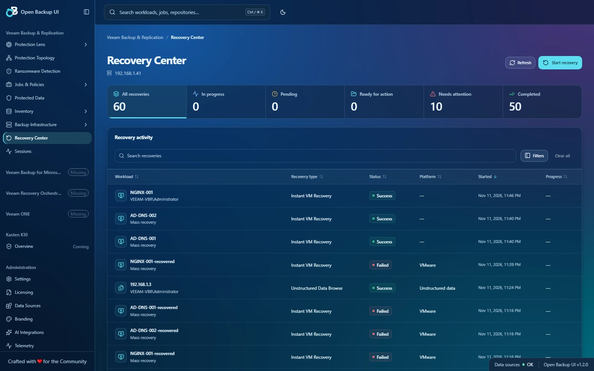
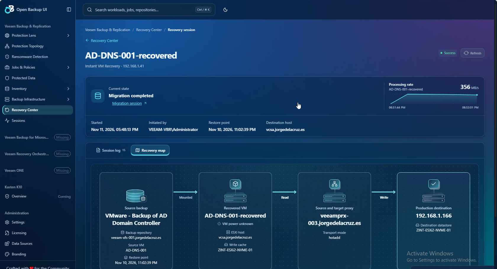
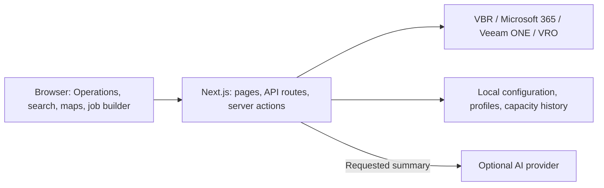

# Open Backup UI

**A community operations and recovery console for Veeam environments.**

See protection health, investigate failures, plan storage, and recover data from one interface. **v1.2.0 introduces Recovery Center**: choose a recovery goal, select a workload and restore point, review the destination, and follow the operation in its own workspace. Browse files, Active Directory objects, and SQL databases inside the recovery session.

[What's new in v1.2.0](docs/releases/v1.2.0.md) · [Validation and release checklist](docs/releases/v1.2.0-validation.md) · [Deployment](docs/deployment.md) · [Contributing](CONTRIBUTING.md)

> [!IMPORTANT]
> This is an independent, community-maintained project, not an official or vendor-supported product. It is provided as-is, without support obligations or SLAs. Test in a lab and review access controls before connecting production systems. Vendor names are used for identification only.

## What's new in v1.2.0

- **Recovery Center:** start with **Entire workload**, **Files, folders and objects**, **Application items**, or **Disks and volumes**. The picker shows eligible workloads and methods for the connected VBR source, with workload search and type filters.
- **A restore-point calendar:** select a workload on the left and inspect its calendar and restore times on the right. The latest eligible point is selected automatically; month/year navigation and **Load more** make older recovery history accessible.
- **VM recovery, individually or together:** Instant VM Recovery and entire-VM restore, with original or customized placement, per-VM restore points and names, and recovery groups for up to 32 VMs. Availability follows VBR's reported capabilities.
- **Files in the session:** browse Windows/Linux guest files in a folder tree, search, collect items, download ZIP archives, and restore with **Keep both copies** or **Overwrite**. The inline cart returns to browsing after submission and keeps progress in one expandable task strip.
- **Application recovery:** embedded Active Directory and SQL Server explorers with selection-scoped actions. Recover or export directory objects; browse SQL instances and databases, restore or instantly recover databases, export, publish, and configure a SQL staging server.
- **More workload families:** NAS/file-share and object-storage recovery from a selected restore point, destination browsing for Copy to, and tracked file operations; physical-computer guest files and supported disk tools. Windows volume restore uses a connected recovery appliance.
- **Recovery maps and migration:** follow the source backup, VM, storage, reported proxies and production destination. Configure migration from the Instant Recovery map; animated read/write paths and processing-rate charts show the work as it happens. Collected rate history remains available for 12 hours after a session finishes.
- **Sessions and recovery activity:** investigate backup and restore runs in Sessions, or focus on recoveries in Recovery Center with Pending, Ready for action and other quick filters. Return links preserve where you started, and cleanup actions stay with the session while applicable.
- **Faster repeated selection:** shared, scoped restore-point caching, local workload search, 30-minute refresh while Recovery Center is open, manual Refresh, and older restore points loaded in batches of 200 per backup copy.
- **A refreshed identity:** the new OB restore-and-check icon, Glass Ocean as the default for new preferences, theme-aware controls, 200 rotating loading captions, and connection status with the release version in the footer.

The [release notes](docs/releases/v1.2.0.md) explain the workflows and their boundaries. Several Explorer and unstructured-data workflows use VBR's private Web APIs; server version, credentials, permissions, and the selected restore point determine which actions are available. This is not complete parity with every native Veeam console.



*Recovery Center brings recovery activity and the next action together. [See eight English, Glass Ocean screenshots](docs/releases/v1.2.0-gallery.md), including the goal picker, restore-point calendar, multi-VM selection, recovery maps and Sessions.*



*An actual completed lab migration, with its reported proxy path and retained processing-rate history.*

## Also included from v1.0.1

- **Kiosk Builder (Labs):** enable it in Settings and build a canvas from sixteen VBR sources and ten visual forms, with editable mappings, series, filters and columns.
- **A layout that makes room:** magnetic alignment, cascading repulsion, consistent padding, undo/redo and browser-local composition import/export.
- **Read-only monitoring screens:** optional password-protected links, configurable refresh and full-screen TV fitting through a dedicated viewer listener. Keep the main console behind your existing access controls.
- **Cached capacity evidence:** repository forecasts, runway, footprint, retention and hygiene widgets, plus a populated forecast miniature in the Lens selector.
- **AI summaries and PDF reports:** clearer provider setup and errors, a panel that follows Branding, and local export of completed analyses with linked contents and embedded multilingual fonts.


*A ten-widget monitoring screen in Glass Aurora. [Explore all 15 release images](docs/releases/v1.0.1-gallery.md), the [Kiosk Builder guide](docs/labs.md), and [AI PDF export](docs/ai-summary-pdf.md).*

## The v1.0 Operations foundation

- **Protection Lens:** Overview, Job Operations, Capacity Watch, and Capacity Forecast, with a compact view selector and a browser-specific default.
- **Capacity planning:** cached backup-file projections, measured repository trends, retention and immutability investigation, and backup-hygiene review, with planning data refreshed in the background every 30 minutes.
- **Job builder and Policy Profiles:** guided VMware/Hyper-V creation with reusable retention, guest-processing, and scheduling settings.
- **Investigation workflows:** workload errors, session/task logs, supported retry chains, recovery evidence, and connected repository details.
- **One Operations experience:** refreshed VBR, Microsoft 365, Veeam ONE, and administration views with consistent grids, expandable filters, date sorting, and breadcrumbs.
- **Faster navigation:** global search with previews, preserved HexMaps, and a phone-friendly main menu.
- **Make it yours:** Operations plus Glass Ocean, Glass Forest, and Glass Aurora themes; fonts, colors, and live appearance previews.
- **Work in your language:** 11 bundled languages, browser-language detection, and localized widgets, statuses, filters, and investigation details across the migrated workspaces.
- **A clearer first connection:** a screenshot showcase introduces the console before you connect a data source; Settings brings language preferences and optional managed HTTPS into one place.

Browse the [visual guide](docs/releases/v1.0.0-gallery.md) for 43 application screenshots, including the Glass themes, Spanish interface, and connection-page showcase. The [full release notes](docs/releases/v1.0.0.md) describe the changes and deployment considerations.


*Protection Lens brings health, investigation priorities, and capacity into one view.*

## Explore the console

### Veeam Backup & Replication

| Workspace | What you can do |
| --- | --- |
| **Protection Lens** | Review estate health, investigate the current job queue, identify capacity pressure, and choose a default Lens. |
| **Capacity Forecast** | Compare retained-file history and projections; explore growth/retention scenarios; review immutability and backup hygiene. Cached planning data refreshes every 30 minutes; a separate collector records physical capacity every 15 minutes. |
| **Jobs & Policies** | Search and filter jobs; sort last/next runs; inspect workloads, sessions, logs, and supported retry chains; retain start, stop, retry, enable, and disable actions. |
| **Job builder** | Create VMware vSphere or Hyper-V backup jobs using live workload/storage choices, policy settings, preflight checks, and a reviewable JSON payload. Existing backup-copy and Entra ID forms remain available. |
| **Policy Profiles** | Save, duplicate, revise, import, and export source-specific retention, guest-processing, and schedule profiles. Applying a profile copies its settings into a new job. |
| **Protected Data** | Switch between coverage inventory and HexMap; inspect restore-point counts, sizes, recovery age, and RPO indicators. Start recovery from an exact calendar/table point and continue in Recovery Center. |
| **Recovery Center** | Choose a recovery goal, select eligible workloads and restore points, launch individual or grouped VM recovery, and follow recovery-only activity. Work inside mounted file, AD and SQL explorers, with session-level cleanup controls. |
| **Sessions** | Follow backup and restore runs, filter by state/type/platform, and inspect logs, workloads and related sessions. Restore detail links retain the section you entered from. |
| **Protection Topology** | Explore confirmed workload → job → repository paths in map/list views; investigate a workload's restore points across repository lanes. |
| **Ransomware Detection** | Review native suspicious-activity events, affected workloads, detection settings, and the separate backup data-reduction indicators. |
| **Backup Infrastructure** | Inspect repository capacity, consumption, scale-out grouping and immutability; proxy transport/task settings; managed-server roles and component updates. |
| **Inventory** | Browse virtual infrastructure with production/protection context, protection groups with agent/discovery health, and file-share/object-storage sources. |

### Microsoft 365 backup

The dashboard combines job health, session history, backup evidence, and repository capacity. Dedicated Operations views cover:

- **Backup Jobs:** schedules, sessions, per-workload errors, and existing job actions.
- **Protected Objects:** users, groups, sites, and teams; HexMap, restore points, reported sizes, and review filters.
- **Organizations:** job health, backup evidence, storage usage, and organization details.
- **Repositories:** disk/cache and object-storage measurements, retention, immutability settings, and job relationships.
- **Proxies:** availability, component updates, and concurrent-task configuration where reported.

### Veeam ONE and Recovery Orchestrator

- **Alarm Operations:** severity, age, affected objects, descriptions, knowledge-base guidance, history, exports, and reviewed resolution actions.
- **Report Operations:** searchable catalog and saved reports, API-driven parameters, execution status, complete paged result tables, summaries, and native charts.
- **Recovery Orchestrator:** search and inspect recovery plans and status.

The revamped Veeam ONE views use native CSS/SVG visuals. Some older application components still use Recharts.

### Search, appearance, and administration

Open global search with **Ctrl/Cmd+K** to find VBR and Microsoft 365 workloads, jobs, and repositories. Scope results, inspect a preview, revisit recent items, and follow labelled approximate matches.

Shared grids use expandable filter groups in a left rail, **Clear all** next to **Filters**, column controls, and sorting where applicable. The phone menu opens above the page content.

Administration includes **Licensing**, **Data Sources**, **Branding & Appearance**, **AI Integrations**, **Telemetry**, and **Identity**. Review usage and expiration, connection/authentication status, API versions, user/role permissions, and local diagnostics. Appearance settings include light/dark mode, fonts, colors, density, radius, layout, sidebar mode, and section names.

**Administration → Settings** adds language selection with automatic browser detection and bundled JSON translations, plus HTTPS certificate status and replacement for the optional managed HTTPS listener. English, Spanish, German, Russian, French, Brazilian Portuguese, Simplified Chinese, Japanese, Italian, Korean, and Hindi are included. See [translation coverage and contribution instructions](docs/i18n.md) and [HTTPS setup](docs/https.md).

Optional AI health summaries support OpenAI, Google Gemini, and Anthropic. Generating a summary sends selected environment context to the configured provider; normal monitoring does not require AI.

### Themes and languages

New browser preferences start with **Glass Ocean**. Choose the compact **Operations** appearance, **Glass Forest**, or **Glass Aurora** in Branding & Appearance; existing saved choices are preserved. Each preset supports light and dark modes, with adjustable accents, typography, density, and sidebar layout. Changes apply instantly, save in this browser, and have an example-data preview.


*Explore the [Forest and Aurora previews](docs/releases/v1.0.0-gallery.md#40--glass-forest) in the visual guide.*

Language selection applies to navigation and shared controls, Protection Lens widgets, jobs and policies, capacity planning, topology, ransomware review, protected data, and the migrated VBR and Microsoft 365 investigation views. Dates and numbers in these views follow the selected locale. Translation catalogs are bundled with the app and require no external translation service.


*The Spanish interface includes application-authored status labels, counts, and guidance. Product names, resource names, paths, and vendor logs retain their original values. See the [coverage notes](docs/i18n.md#coverage) for the current scope and remaining legacy views.*

The **Connect** page introduces features through nine real application screenshots: Protection Lens, forecasting, HexMap, job creation, Microsoft 365, three Glass themes, and the Spanish interface. Captions are translated and slideshow controls let you choose what to explore. The images retain the language in which they were captured.


## Get started

### Requirements

- Node.js 20 or later and npm. The local v1.0 build was checked with Node.js 22.
- Network access **from the application server** to the supported platform APIs.
- Appropriate platform credentials and a persistent, writable `data/` directory.

```bash
git clone https://github.com/jorgedlcruz/open-backup-ui.git
cd open-backup-ui
npm ci
npm run dev
```

Open [http://localhost:3000/connect](http://localhost:3000/connect), add a data source, connect, and continue to the dashboard. Manage sources later in **Administration → Data Sources**. The interface currently supports one configured source per platform type.

Run `npm ci` after cloning or extracting the source on a new machine; dependencies are not included in the download. Ordinary `npm install` is also supported. Neither command needs `--legacy-peer-deps` or `--force`.

The release source ZIP includes the application, tests, documentation, release screenshots, and connection-page images. It excludes installed dependencies, generated builds, local credentials, and runtime `data/`. Configure your own connections after extracting it; keep your existing instance's `data/` and encryption key when upgrading.

To create the source package locally, run `npm run package:source`. It writes `artifacts/open-backup-ui-v1.2.0.zip` and a matching SHA-256 checksum file. Packaging uses only Node.js built-ins and can run before dependency installation.

The separate Linux standalone release includes the production build and runtime dependencies. Follow [standalone startup instructions](STANDALONE.md) to run it directly; use the source ZIP to install and build on Windows, macOS, or another architecture.

### Commands

| Command | Purpose |
| --- | --- |
| `npm run dev` | Development server with Turbopack |
| `npm run build` | Full production build, including Next.js lint/type checks |
| `npm start` | Production server; see the TLS behavior below |
| `npm run start:https` | Optional HTTPS listener with a persistent per-install certificate and live certificate replacement |
| `npm run package:source` | Complete source ZIP with documentation, screenshot assets, and SHA-256 checksum |
| `npm test` | Complete automated regression suite |
| `npm run typecheck` | Standalone TypeScript check |
| `npm run lint` | ESLint |
| `npm run version:files` | Synchronize source headers and the tracked-file version manifest with `package.json` |
| `npm run test:forecast` | Forecast, retention/storage investigation, and collector tests |
| `npm run test:job-builder` | Job/profile models, native API contract, and submission safeguards |

Additional `test:*` commands in `package.json` cover each platform and workspace.

## API coverage and evidence

| Platform | Current integration |
| --- | --- |
| **VBR** | Public `/api/v1` with `1.3-rev1` and selected `1.3-rev2` readers/actions. Explorer, recovery and unstructured-data workflows also use authenticated `/private-api/v1` Web API routes. See the [Recovery Center workflow guide](docs/recovery-center-workflows.md). |
| **Microsoft 365 backup** | `/v8` resource routes; stored-source authentication currently uses `/v7/Token`. |
| **Veeam ONE** | `/api/v2.3` reporting and alarm routes. |
| **Recovery Orchestrator** | `/api/v7.21/Plans`. |
| **Kasten K10** | Placeholder; monitoring is not implemented. |

This is an implementation summary, not a certification matrix. Versions and permissions determine available fields and actions. Missing, stale, partial, and unsupported evidence is shown explicitly in the new Operations views.

Forecasts are advisory. Retained-file history is not historical disk usage, and file sizes are not necessarily physical allocation or reclaimable space. Physical trends need at least three daily readings spanning 48 hours. Recovery-point counts, successful jobs, and an absence of malware events do not establish recoverability or a secure environment.

## Deployment and data

Use a persistent Node server or container for unattended capacity collection. Persist `data/` and the encryption key across upgrades. Profiles and capacity history are local to the application instance; this is not a distributed or multi-tenant service.

Capacity planning uses a server-memory cache scoped to the authenticated source and principal. Saved VBR connections refresh their planning evidence in the background every 30 minutes, even with the browser closed. The page shows the snapshot time and refresh state; **Refresh** requests current evidence immediately. Transient refresh failures retain the previous snapshot with a visible warning. The cache rebuilds after a server restart. Browser-only sessions can use the cache while connected but cannot refresh unattended; `CAPACITY_COLLECTOR_ENABLED=false` disables both background planning refresh and physical-capacity collection.

Recovery Center has a separate catalog and restore-point cache. It reuses scoped evidence for responsive search and selection, refreshes while the page remains open, and supports a manual page Refresh. Older-point requests extend the cache in 200-point pages per backup copy. Recovery receipts, batch state and short-lived throughput history use local runtime storage; preserve `data/` when updating the application. An interrupted or unconfirmed request must be checked in the session before submitting another restore.

**Access and TLS:** the app can use saved platform credentials and perform management actions. Put shared instances behind an authenticated access layer. The existing `npm start` script disables outbound TLS certificate verification; review the [deployment guide](docs/deployment.md) before production use. A phone only needs access to this web app, not to the backup servers.

[Deployment, remote access, environment variables, and data handling](docs/deployment.md) · [Container instructions](CONTAINER.md)

## Architecture



Built with Next.js 15, React 19, TypeScript, Tailwind CSS 4, Radix/shadcn controls, TanStack Table, React Flow/ELK, and native CSS/SVG Operations visuals.

- `app/`: platform pages, authenticated-source API readers, and actions.
- `components/`: shared Operations controls and domain workspaces.
- `lib/`: API adapters, evidence models, forecasting, search, profiles, and local stores.
- `tests/`: model, loading, API-contract, isolation, and regression checks.
- `data/`: ignored runtime configuration, encrypted secrets, profiles, and capacity observations.
- `docs/`: release notes, screenshots guide, deployment, and implementation details.

## Current boundaries

- Analytics → Dashboards, Analytics → Threat Center, and Kasten remain placeholders. The VBR Ransomware Detection workspace is implemented.
- Disabled creation-menu entries are not implemented. Reusable profiles apply to the new VMware/Hyper-V builder; they do not modify existing jobs automatically.
- API coverage and mutation support vary by platform and job type. A successful connection does not validate every operation.
- Mass recovery is limited to VM Instant Recovery and entire-VM restore; it is not a cross-workload recovery orchestrator. Selected points must share a supported method.
- Recovery uses both public and private VBR APIs. Private Web API compatibility can change between VBR releases; see the [validation scope](docs/releases/v1.2.0-validation.md). AD comparison against production and an embedded VMware console are not included.
- Some legacy Veeam ONE client paths still contain explicit demo/report fixtures; confirm data provenance for the workflow you use.
- Polling and collection intervals vary. The application is not a real-time event stream or a substitute for a restore test.

## Documentation and community

- [v1.2.0 release notes](docs/releases/v1.2.0.md), [PR description](docs/releases/v1.2.0-pull-request.md), and [validation/publication checklist](docs/releases/v1.2.0-validation.md)
- [v1.0.1 release notes](docs/releases/v1.0.1.md), [visual guide](docs/releases/v1.0.1-gallery.md), and [validation scope](docs/releases/v1.0.1-validation.md)
- [Kiosk Builder and sharing](docs/labs.md) and [AI summary PDF export](docs/ai-summary-pdf.md)
- [v1.0 release notes](docs/releases/v1.0.0.md) and [screenshot checklist](docs/releases/v1.0.0-screenshots.md)
- [Operations implementation and metric definitions](docs/operations-revamp.md)
- [Protection Topology](docs/protection-topology.md)
- [Deployment](docs/deployment.md), [containers](CONTAINER.md), and [troubleshooting](TROUBLESHOOTING.md)
- [Contributing](CONTRIBUTING.md), [Developer Certificate of Origin](DCO.md), and [license](LICENSE)

Originally developed for the [Veeam Community Hackathon 2025](https://github.com/VeeamCommunity/veeamcommunity-2025-Team-1/). Issues and contributions are welcome; support is best-effort community support, not Veeam Support.
