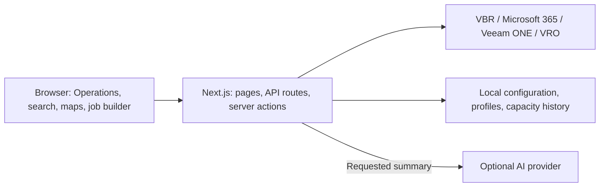

# Open Backup UI

**A community Operations console for Veeam environments.**

See protection health, investigate failures, explore recovery evidence, and plan storage from one interface. Open Backup UI **v1.0.0** brings a consistent Operations experience to Veeam Backup & Replication, Veeam Backup for Microsoft 365, Veeam ONE, and administration.

[What's new in v1.0](docs/releases/v1.0.0.md) · [Visual guide](docs/releases/v1.0.0-gallery.md) · [Deployment](docs/deployment.md) · [Contributing](CONTRIBUTING.md)

> [!IMPORTANT]
> This is an independent, community-maintained project, not an official or vendor-supported product. It is provided as-is, without support obligations or SLAs. Test in a lab and review access controls before connecting production systems. Vendor names are used for identification only.

## What's new in v1.0

- **Protection Lens:** Overview, Job Operations, Capacity Watch, and Capacity Forecast, with a compact view selector and a browser-specific default.
- **Capacity planning:** backup-file projections, measured repository trends, retention and immutability investigation, and backup-hygiene review.
- **Job builder and Policy Profiles:** guided VMware/Hyper-V creation with reusable retention, guest-processing, and scheduling settings.
- **Investigation workflows:** workload errors, session/task logs, supported retry chains, recovery evidence, and connected repository details.
- **One Operations experience:** refreshed VBR, Microsoft 365, Veeam ONE, and administration views with consistent grids, expandable filters, date sorting, and breadcrumbs.
- **Faster navigation:** global search with previews, preserved HexMaps, and a phone-friendly main menu.
- **Make it yours:** Operations plus Glass Ocean, Glass Forest, and Glass Aurora themes; fonts, colors, and live appearance previews.

The [full release notes](docs/releases/v1.0.0.md) include 38 feature screenshots. Browse the [visual guide](docs/releases/v1.0.0-gallery.md) for captions and current navigation routes.


*Protection Lens brings health, investigation priorities, and capacity into one view.*

## Explore the console

### Veeam Backup & Replication

| Workspace | What you can do |
| --- | --- |
| **Protection Lens** | Review estate health, investigate the current job queue, identify capacity pressure, and choose a default Lens. |
| **Capacity Forecast** | Compare retained-file history and projections; explore growth/retention scenarios; review immutability and backup hygiene. A server collector records capacity every 15 minutes. |
| **Jobs & Policies** | Search and filter jobs; sort last/next runs; inspect workloads, sessions, logs, and supported retry chains; retain start, stop, retry, enable, and disable actions. |
| **Job builder** | Create VMware vSphere or Hyper-V backup jobs using live workload/storage choices, policy settings, preflight checks, and a reviewable JSON payload. Existing backup-copy and Entra ID forms remain available. |
| **Policy Profiles** | Save, duplicate, revise, import, and export source-specific retention, guest-processing, and schedule profiles. Applying a profile copies its settings into a new job. |
| **Protected Data** | Switch between coverage inventory and HexMap; inspect restore-point counts, sizes, recovery age, and RPO indicators. Open restore-point tables/calendars and recovery evidence. |
| **Protection Topology** | Explore confirmed workload → job → repository paths in map/list views; investigate a workload's restore points across repository lanes. |
| **Ransomware Detection** | Review native suspicious-activity events, affected workloads, detection settings, and the separate backup data-reduction indicators. |
| **Backup Infrastructure** | Inspect repository capacity, consumption, scale-out grouping and immutability; proxy transport/task settings; managed-server roles and component updates. |
| **Inventory** | Browse virtual infrastructure with production/protection context, protection groups with agent/discovery health, and file-share/object-storage sources. |

### Microsoft 365 backup

The dashboard combines job health, session history, backup evidence, and repository capacity. Dedicated Operations views cover:

- **Backup Jobs:** schedules, sessions, per-workload errors, and existing job actions.
- **Protected Objects:** users, groups, sites, and teams; HexMap, restore points, reported sizes, and review filters.
- **Organizations:** job health, backup evidence, storage usage, and organization details.
- **Repositories:** disk/cache and object-storage measurements, retention, immutability settings, and job relationships.
- **Proxies:** availability, component updates, and concurrent-task configuration where reported.

### Veeam ONE and Recovery Orchestrator

- **Alarm Operations:** severity, age, affected objects, descriptions, knowledge-base guidance, history, exports, and reviewed resolution actions.
- **Report Operations:** searchable catalog and saved reports, API-driven parameters, execution status, complete paged result tables, summaries, and native charts.
- **Recovery Orchestrator:** search and inspect recovery plans and status.

The revamped Veeam ONE views use native CSS/SVG visuals. Some older application components still retain Recharts/Tremor dependencies.

### Search, appearance, and administration

Open global search with **Ctrl/Cmd+K** to find VBR and Microsoft 365 workloads, jobs, and repositories. Scope results, inspect a preview, revisit recent items, and follow labelled approximate matches.

Shared grids use expandable filter groups in a left rail, **Clear all** next to **Filters**, column controls, and sorting where applicable. The phone menu opens above the page content.

Administration includes **Licensing**, **Data Sources**, **Branding & Appearance**, **AI Integrations**, **Telemetry**, and **Identity**. Review usage and expiration, connection/authentication status, API versions, user/role permissions, and local diagnostics. Appearance settings include light/dark mode, fonts, colors, density, radius, layout, sidebar mode, and section names.

Optional AI health summaries support OpenAI, Google Gemini, and Anthropic. Generating a summary sends selected environment context to the configured provider; normal monitoring does not require AI.

## Get started

### Requirements

- Node.js 20 or later and npm. The local v1.0 build was checked with Node.js 22.
- Network access **from the application server** to the supported platform APIs.
- Appropriate platform credentials and a persistent, writable `data/` directory.

```bash
git clone https://github.com/jorgedlcruz/open-backup-ui.git
cd open-backup-ui
npm ci --legacy-peer-deps
npm run dev
```

Open [http://localhost:3000/connect](http://localhost:3000/connect), add a data source, connect, and continue to the dashboard. Manage sources later in **Administration → Data Sources**. The interface currently supports one configured source per platform type.

The locked dependency set requires legacy peer resolution; use the same install command locally, in CI, and in containers.

### Commands

| Command | Purpose |
| --- | --- |
| `npm run dev` | Development server with Turbopack |
| `npm run build` | Full production build, including Next.js lint/type checks |
| `npm start` | Production server; see the TLS behavior below |
| `npm test` | Complete automated regression suite |
| `npm run typecheck` | Standalone TypeScript check |
| `npm run lint` | ESLint |
| `npm run test:forecast` | Forecast, retention/storage investigation, and collector tests |
| `npm run test:job-builder` | Job/profile models, native API contract, and submission safeguards |

Additional `test:*` commands in `package.json` cover each platform and workspace.

## API coverage and evidence

| Platform | Current integration |
| --- | --- |
| **VBR** | Primarily `/api/v1` with `1.3-rev1`; selected investigation/builder readers negotiate `1.3-rev2` for supported server builds. |
| **Microsoft 365 backup** | `/v8` resource routes; stored-source authentication currently uses `/v7/Token`. |
| **Veeam ONE** | `/api/v2.3` reporting and alarm routes. |
| **Recovery Orchestrator** | `/api/v7.21/Plans`. |
| **Kasten K10** | Placeholder; monitoring is not implemented. |

This is an implementation summary, not a certification matrix. Versions and permissions determine available fields and actions. Missing, stale, partial, and unsupported evidence is shown explicitly in the new Operations views.

Forecasts are advisory. Retained-file history is not historical disk usage, and file sizes are not necessarily physical allocation or reclaimable space. Physical trends need at least three daily readings spanning 48 hours. Recovery-point counts, successful jobs, and an absence of malware events do not establish recoverability or a secure environment.

## Deployment and data

Use a persistent Node server or container for unattended capacity collection. Persist `data/` and the encryption key across upgrades. Profiles and capacity history are local to the application instance; this is not a distributed or multi-tenant service.

**Access and TLS:** the app can use saved platform credentials and perform management actions. Put shared instances behind an authenticated access layer. The existing `npm start` script disables outbound TLS certificate verification; review the [deployment guide](docs/deployment.md) before production use. A phone only needs access to this web app, not to the backup servers.

[Deployment, remote access, environment variables, and data handling](docs/deployment.md) · [Container instructions](CONTAINER.md)

## Architecture



Built with Next.js 15, React 19, TypeScript, Tailwind CSS 4, Radix/shadcn controls, TanStack Table, React Flow/ELK, and native CSS/SVG Operations visuals.

- `app/`: platform pages, authenticated-source API readers, and actions.
- `components/`: shared Operations controls and domain workspaces.
- `lib/`: API adapters, evidence models, forecasting, search, profiles, and local stores.
- `tests/`: model, loading, API-contract, isolation, and regression checks.
- `data/`: ignored runtime configuration, encrypted secrets, profiles, and capacity observations.
- `docs/`: release notes, screenshots guide, deployment, and implementation details.

## Current boundaries

- Analytics → Dashboards, Analytics → Threat Center, and Kasten remain placeholders. The VBR Ransomware Detection workspace is implemented.
- Disabled creation-menu entries are not implemented. Reusable profiles apply to the new VMware/Hyper-V builder; they do not modify existing jobs automatically.
- API coverage and mutation support vary by platform and job type. A successful connection does not validate every operation.
- Some legacy Veeam ONE client paths still contain explicit demo/report fixtures; confirm data provenance for the workflow you use.
- Polling and collection intervals vary. The application is not a real-time event stream or a substitute for a restore test.

## Documentation and community

- [v1.0 release notes](docs/releases/v1.0.0.md) and [screenshot checklist](docs/releases/v1.0.0-screenshots.md)
- [Operations implementation and metric definitions](docs/operations-revamp.md)
- [Protection Topology](docs/protection-topology.md) and [workload resilience](docs/workload-resilience.md)
- [Deployment](docs/deployment.md), [containers](CONTAINER.md), and [troubleshooting](TROUBLESHOOTING.md)
- [Contributing](CONTRIBUTING.md), [Developer Certificate of Origin](DCO.md), and [license](LICENSE)

Originally developed for the [Veeam Community Hackathon 2025](https://github.com/VeeamCommunity/veeamcommunity-2025-Team-1/). Issues and contributions are welcome; support is best-effort community support, not Veeam Support.
