# Open Backup UI v1.0.0

**A new Operations experience, from the morning health check to the workload behind a failed backup.**

Version 1.0 brings focused Protection Lens views, capacity forecasting, reusable Policy Profiles, and a consistent interface across Veeam Backup & Replication, Microsoft 365 backup, Veeam ONE, and administration.

Screenshots show the project lab during the v1.0 revamp. Some captures predate the final navigation and filter refinements; the [visual guide](v1.0.0-gallery.md) identifies the capture set and provides current routes.

## The highlights

- **See what matters:** four Protection Lens views, each with its own operational metrics.
- **Investigate in context:** follow workloads, jobs, sessions, restore points, and repositories without losing the thread.
- **Plan ahead:** explore storage growth, retention, immutability, and backup hygiene.
- **Build once, reuse often:** a new job builder with reusable retention, guest-processing, and schedule profiles.
- **Move faster:** global search with previews, expandable filters, sortable grids, and phone navigation.

## Protection Lens

### Your protection picture, four ways

Choose **Overview**, **Job Operations**, **Capacity Watch**, or **Capacity Forecast** from a compact Lens selector with live mini previews. Mark a Lens as your default starting view for this browser.

*One protection picture. Four focused views.*

### Job Operations

Move straight from failed, warning, active, or disabled jobs to the evidence that needs investigation. Search the queue, inspect sessions, and export the matching records.

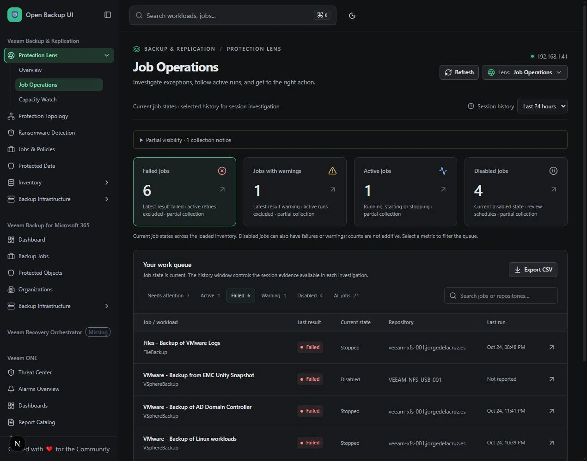

*Start with the jobs that need attention.*

### Capacity Watch

Find repositories under pressure with capacity, free space, availability, and affected-job context. Missing measurements remain visible instead of appearing healthy.

*Find storage pressure before the next backup.*

### Capacity Forecast

Compare retained backup-file history with a distinctly styled projection, then explore retention and incremental-growth scenarios. A separate physical-capacity trend uses collected repository measurements; it does not confuse file sizes with occupied disk blocks.

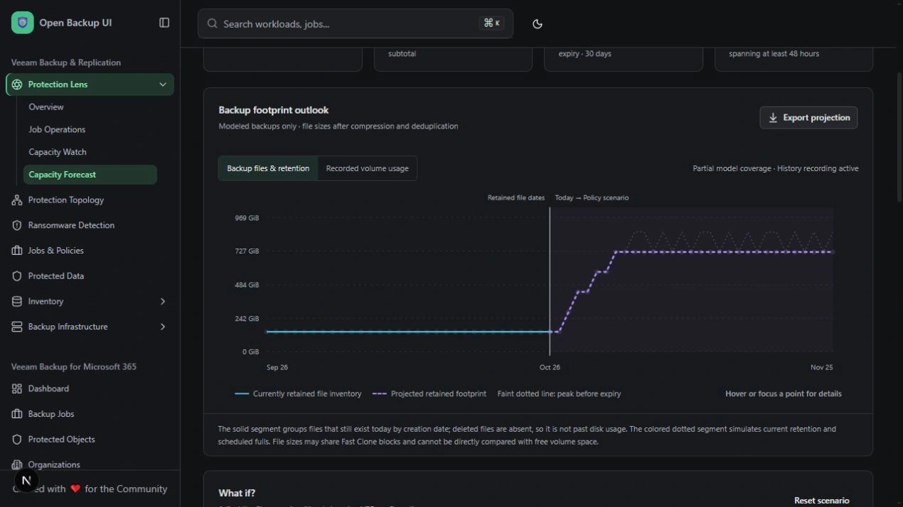

*Explore tomorrow's storage demand.*

### Retention, immutability, and backup hygiene

Investigate why files are retained, where configured immutability outlasts retention, and which backups need review. The background collector records capacity every 15 minutes while the server runs, even with no browser open.

*Understand why backup files are retained.*

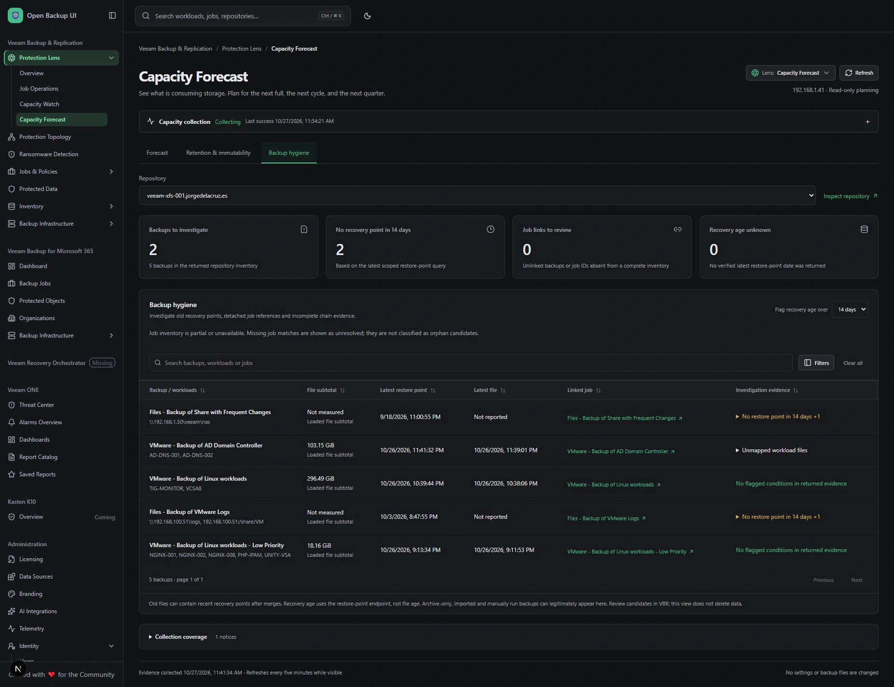

*Review stale backups and unresolved ownership.*

## Jobs and recovery

### Jobs & Policies, redesigned

The job inventory now shares the Operations table styling, expanding search, compact controls, column choices, and pagination. Sort by last or next run and keep the existing creation and job-management actions close at hand.

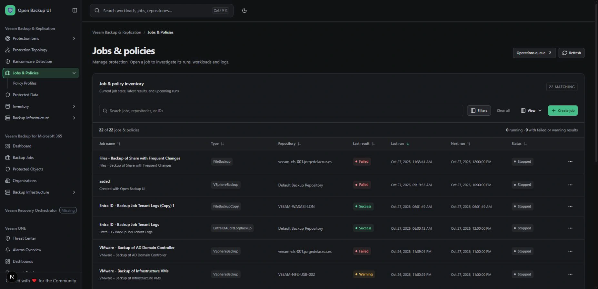

*A consistent home for jobs and policies.*

### A clearer job builder

Create VMware vSphere and Hyper-V jobs through four focused stages: workloads, storage, policies, and review. Browse live inventory, check the configuration against the source before submission, and inspect or export the API payload.

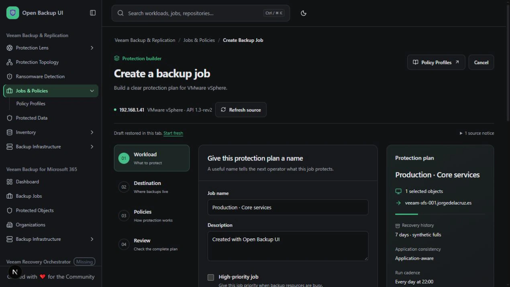

*Build a protection plan in four focused steps.*

### Policy Profiles

Save reusable **retention**, **guest-processing**, and **schedule** settings under **Jobs & Policies → Policy Profiles**. Import, export, duplicate, and revise profiles, then apply a copy to a new job. Updating a profile does not silently change existing jobs.

*Define shared settings once. Reuse them in new jobs.*

### Job and session investigation

Bring session history, per-workload errors, session logs, and task logs into one investigation flow. Follow retry chains when the API supplies the relationships, and export the filtered log evidence.

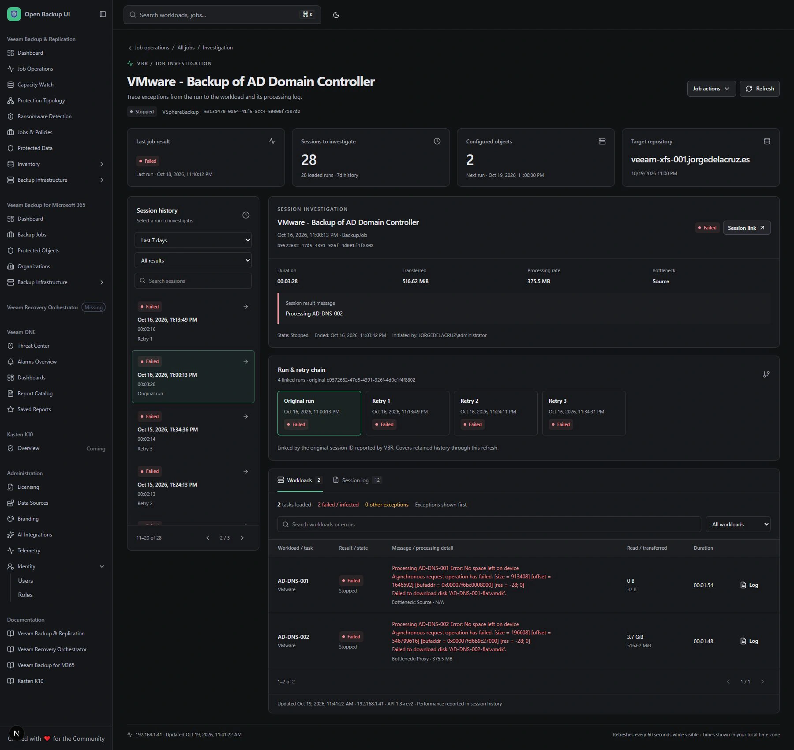

*Follow the failure down to the workload.*

### Protected Data and HexMap

Review backup coverage, restore-point counts, reported sizes, and recovery age in a consistent inventory. Keep the HexMap toggle, now with workload names, clearer RPO colors, smarter time-unit controls, and cached loading.

*Scan recovery age without losing workload identity.*

### Restore-point investigation

Inspect freshness, repository location, reported malware status, and available recovery operations in the Operations layout. Shared backup files are counted once, and unavailable values remain explicit.

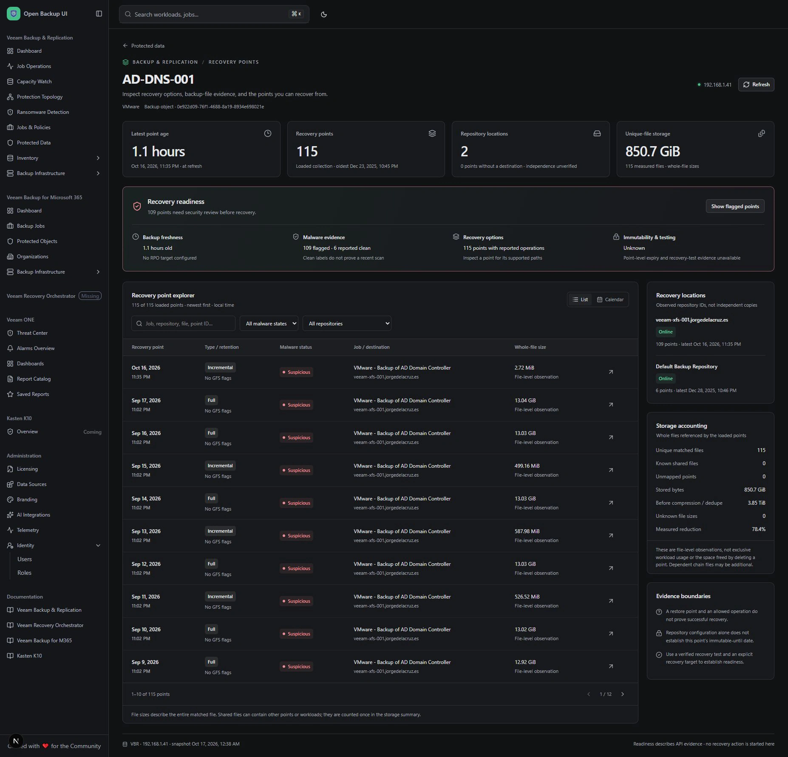

*Inspect recovery options and their supporting evidence.*

### Protection Topology and workload resilience

Follow confirmed **workload → job → repository** relationships in a map or list. Open a workload's resilience explorer to compare restore points across repository lanes and investigate protection gaps.

*Trace workload, job, and repository relationships.*

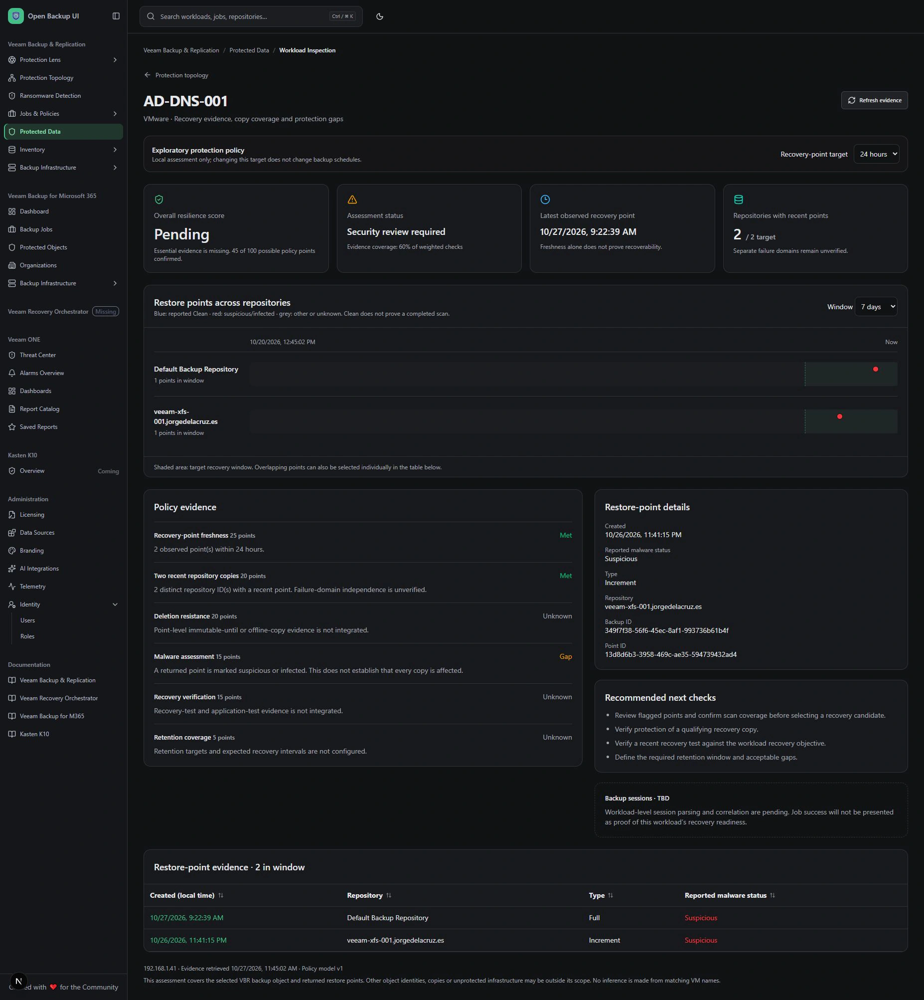

*Compare recovery evidence across locations.*

### Ransomware Detection

Review native suspicious-activity events, affected workloads, detection settings, and recovery-point links. The existing backup data-reduction indicators remain available as a separate investigation view.

*Investigate suspicious activity in context.*

## Infrastructure and inventory

### Storage investigation in one place

Repository lists and details bring together scale-out grouping, capacity, backup consumption, immutability configuration, and directly affected jobs.

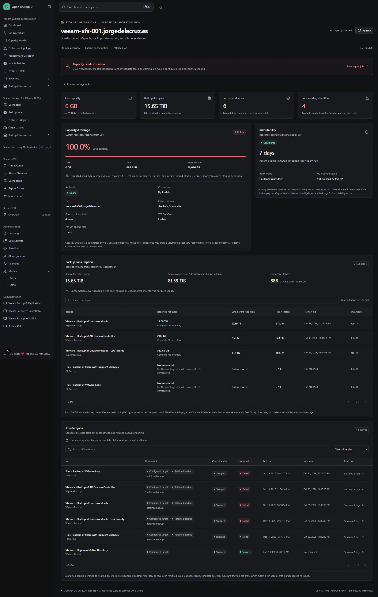

*One storage investigation workspace.*

### Proxies and managed servers

Investigate proxy availability, transport modes, and concurrent-task limits. Managed-server views add component-update status and assigned roles, with consistent issue filters and drill-downs.

*See the proxy conditions behind backup performance.*

*Review server readiness and responsibilities.*

### Production and protection together

Virtual Infrastructure keeps its vCenter, cluster, host, VM, size, and protection data in the new layout. Protection Groups expose discovery and agent health; Unstructured Data covers file shares and object storage while preserving existing actions.

*Production and protection, together.*

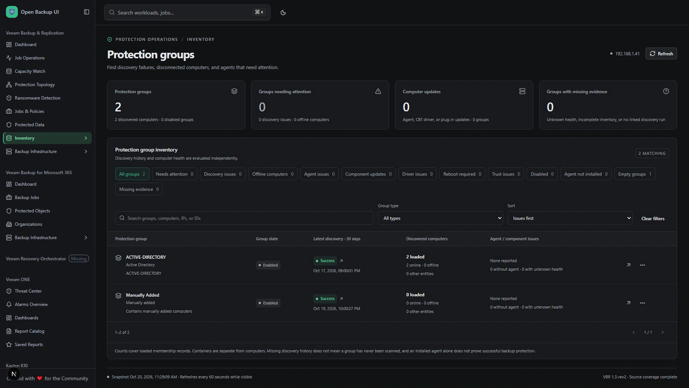

*Spot discovery, agent, and update issues.*

*Keep unstructured protection in view.*

## Microsoft 365 and Veeam ONE

### Microsoft 365 Operations

The dashboard, backup jobs, protected objects, organizations, repositories, and proxies now share the Operations experience. Review job health, sessions and workload errors, backup evidence, storage usage, immutability settings, and proxy availability. Protected Objects retains its HexMap.

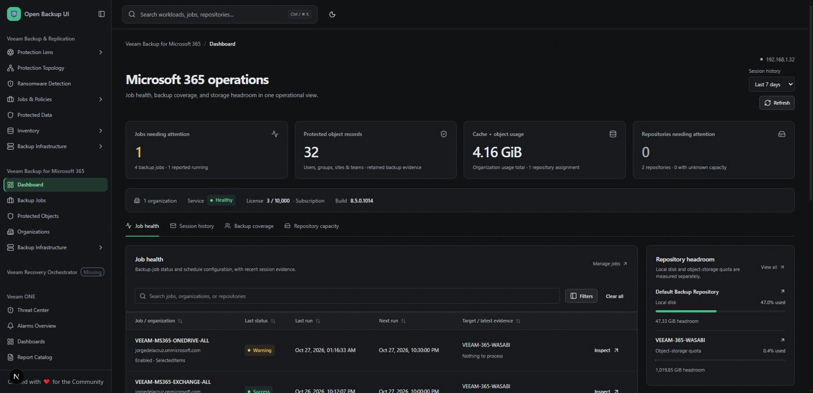

*The Operations experience for Microsoft 365.*

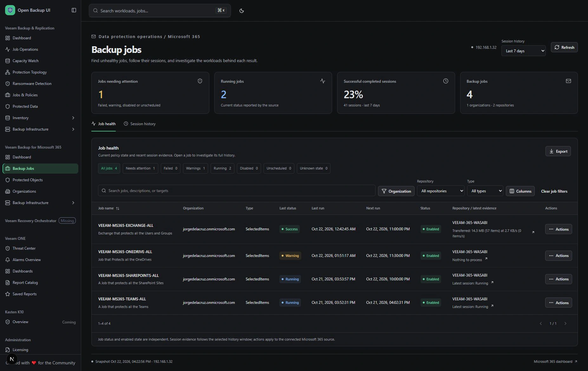

*Investigate Microsoft 365 backup failures.*

*Explore protected objects and their recovery evidence.*

*Understand protection at the organization level.*

*See capacity and immutability without mixing storage types.*

*Review proxy readiness in one place.*

### Veeam ONE Alarm Operations

Investigate severity, affected objects, alarm age, history, full descriptions, and knowledge-base guidance. Native CSS/SVG visuals replace the legacy overview charts, with existing exports and resolution actions preserved.

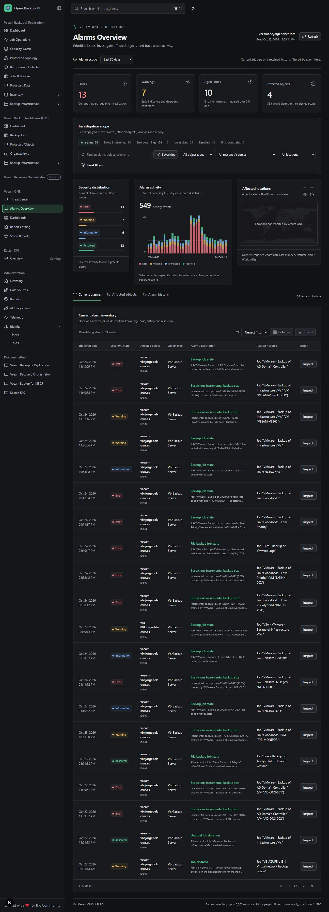

*Turn alarm volume into an investigation queue.*

### Veeam ONE Report Operations

Browse the report catalog and saved reports, set API-driven parameters, follow execution status, and inspect complete paged results. Tables, summaries, and native charts retain source values and links to the native viewer.

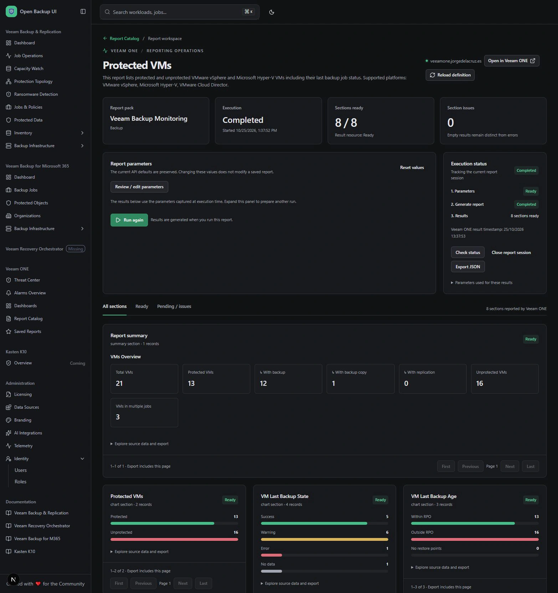

*From report selection to usable results.*

## A consistent experience

### Global search with context

Search VBR and Microsoft 365 workloads, jobs, and repositories from a keyboard-friendly search workspace. Scope results, preview health and recovery facts, revisit recent items, and follow suggested matches for small typing mistakes.

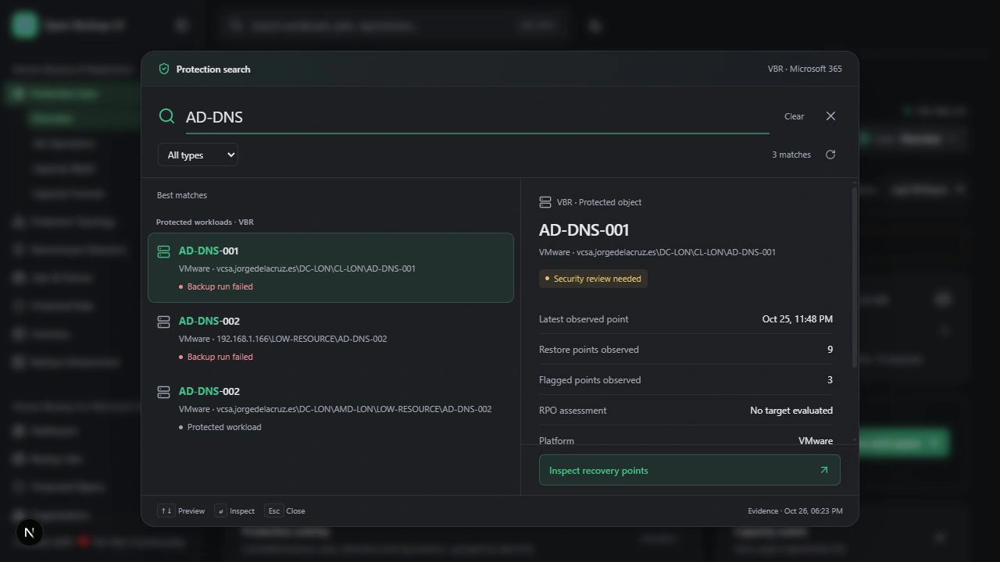

*Find the object. Preview the context. Jump into investigation.*

### Less toolbar clutter

Expandable filter groups live in a left rail, with selectable options and **Clear all** beside **Filters**. Grids gain consistent sorting, date ordering, compact controls, and breadcrumbs. On phones, the main menu opens above the content.

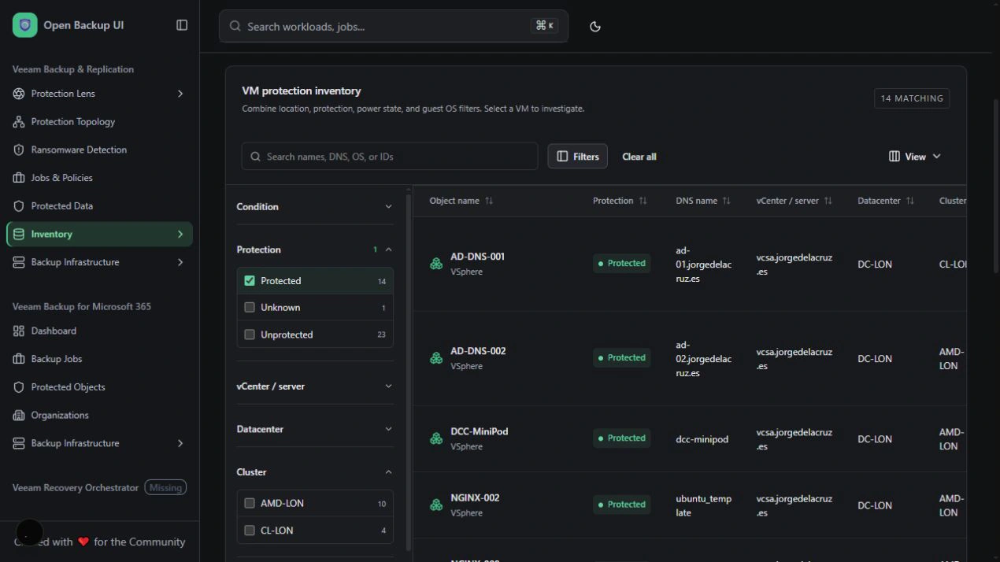

*Powerful filters with less toolbar clutter.*

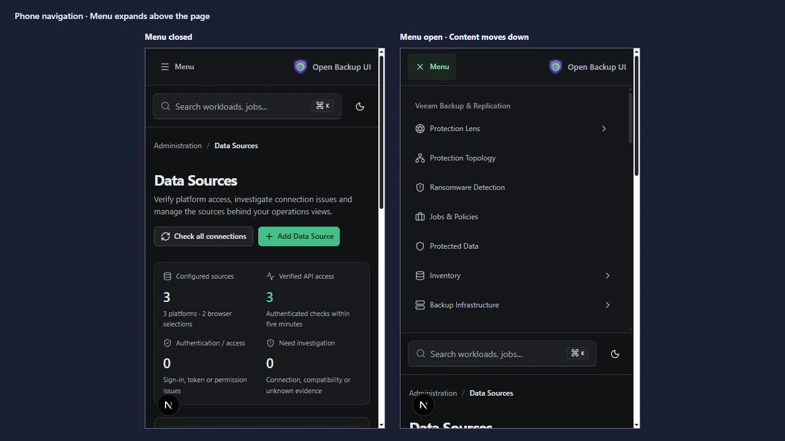

*Navigation that fits a phone.*

### Operations and Glass themes

Choose the Operations theme or **Glass Ocean**, **Glass Forest**, and **Glass Aurora** for layered backgrounds and translucent panels. Branding includes fonts, colors, density, and a live preview.

*Choose the atmosphere. Keep the same operational clarity.*

### Administration, brought together

Licensing combines usage, capacity, and expiration across VBR and Microsoft 365. Data Sources, AI Integrations, Telemetry, and Identity receive consistent configuration, status, diagnostics, and investigation views.

*Review license headroom and upcoming expirations.*

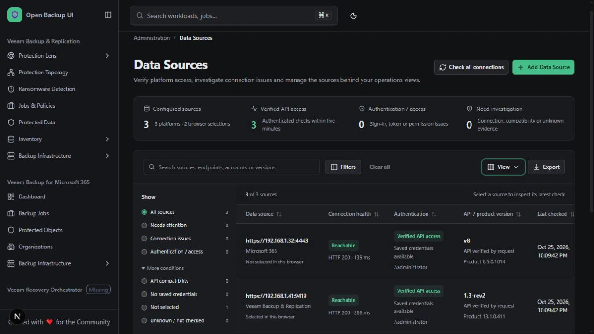

*Know which connections are ready.*

*Configure optional AI summaries on your terms.*

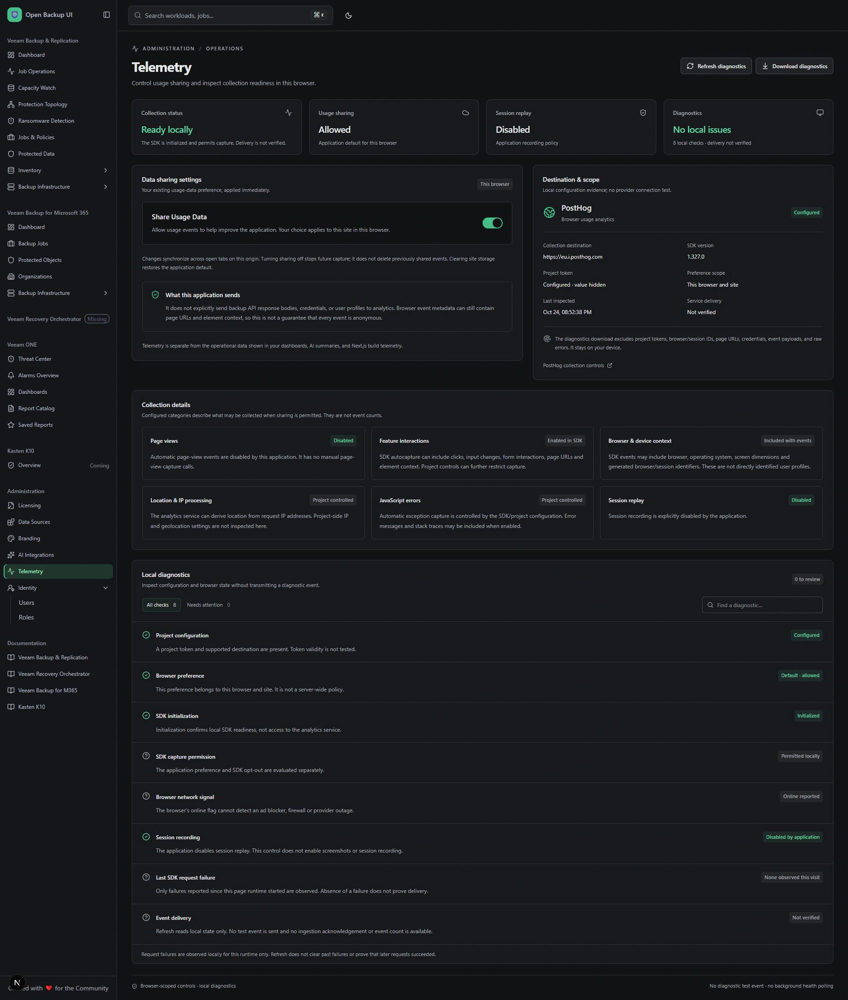

*See and control telemetry behavior.*

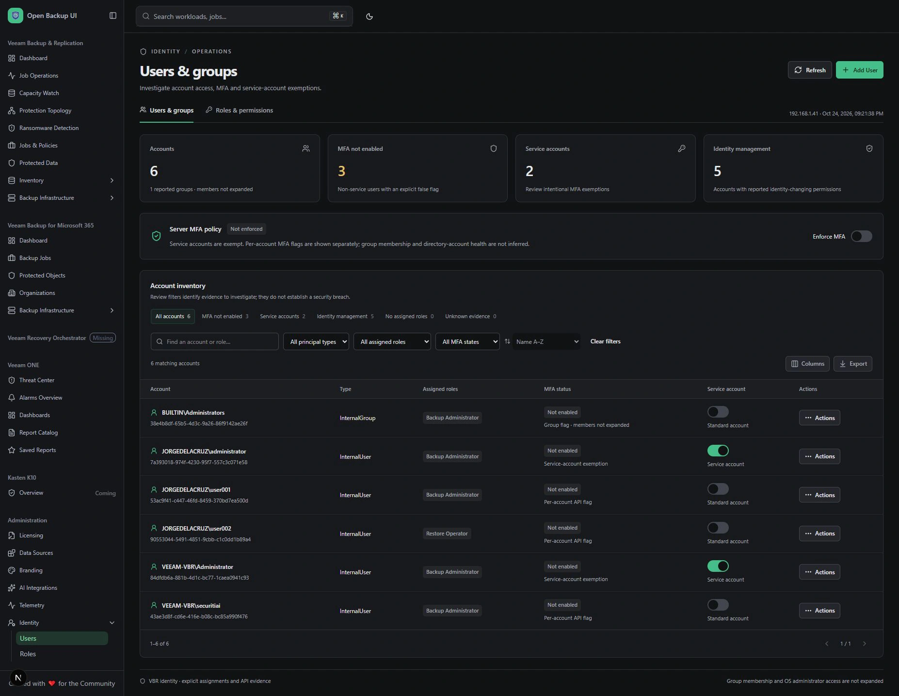

*Investigate access with users, roles, and permissions together.*

## Before upgrading

- Back up the persistent `data/` directory and its encryption key. Policy Profiles and capacity history are stored locally with the existing configuration.
- Capacity collection needs a persistent Node server or container and writable storage. Physical forecasting needs at least three daily readings spanning 48 hours.
- API versions, permissions, and returned evidence determine available features. Unknown or partial evidence is labelled; a successful backup or a displayed restore point is not proof of recoverability.
- Forecasts and backup-hygiene findings are advisory. They do not delete files, change retention, or prove that space is reclaimable.
- Review [deployment and access requirements](../deployment.md) before sharing an instance. This remains an independent community project, not a vendor-supported product.

[README](../../README.md) · [Screenshot checklist](v1.0.0-screenshots.md)
