# v1.0.1 visual guide

Fifteen reviewed images show Kiosk Builder, its current saved and published compositions, TV mode, cached forecasts, AI setup and summary presentation, and PDF export. Nine kiosk images were captured on 1 November 2026. Six reviewed captures from 30 October–1 November document the related features; differences from the final interface are noted below.

These are application captures from the project lab, plus the rendered cover of an actual exported report. The PDF dialog contains a designed miniature preview. Lab names, hostnames, addresses and operational counts remain visible. No visible passwords, API keys, license identifiers, usable share tokens, saved connection files or raw attachments are included.

The WebP images preserve the captured dimensions and framing, with compression only. Browser address bars are absent; public routes use a placeholder in this guide. The new editor captures did not modify the saved composition or published sharing configuration. The separate-origin empty canvas preference was restored after capture.

[Release notes](v1.0.1.md) · [Capture checklist](v1.0.1-screenshots.md) · [Validation scope](v1.0.1-validation.md)

## 01 · Start with an empty canvas.

`/labs` · 1 November 2026 · 1270 × 965

Operations dark; Spanish navigation with experimental English copy. Captured on a separate browser origin without replacing the saved canvas.

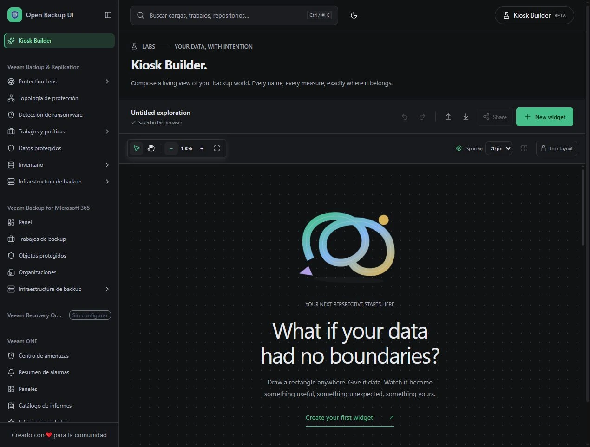

[Open full-size image](images/v1.0.1/01-empty-canvas.webp)

## 02 · Your data, arranged for your day.

`/labs` · 1 November 2026 · 1270 × 965

Current saved My Kiosk composition, Glass Aurora, at Fit canvas zoom. The editor scrolls to additional widgets below.

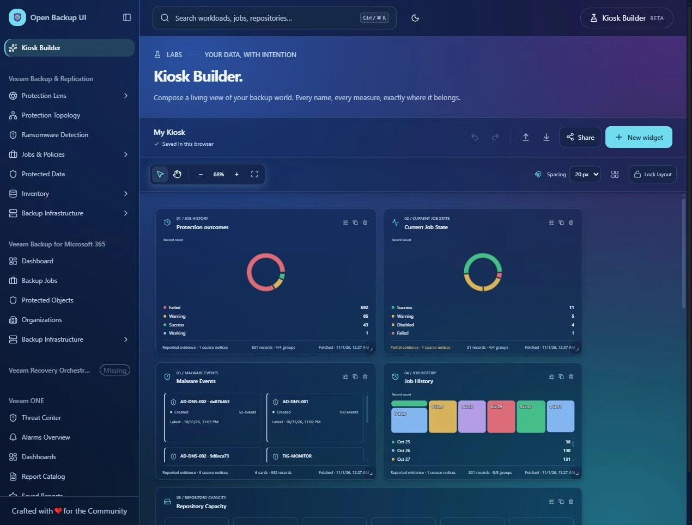

[Open full-size image](images/v1.0.1/02-current-kiosk.webp)

## 03 · Choose the evidence behind the view.

`/labs` · 1 November 2026 · 1280 × 720

The source chooser shows the first eight of sixteen VBR sources; the remaining sources are below the fold.

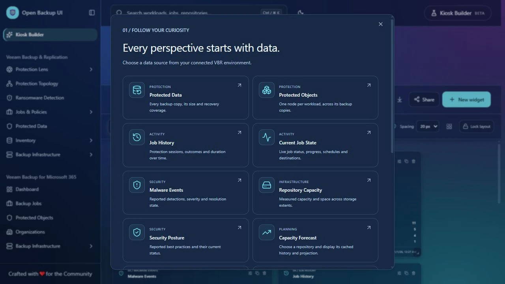

[Open full-size image](images/v1.0.1/03-data-sources.webp)

## 04 · Give the data a shape.

`/labs` · 1 November 2026 · 1280 × 720

All ten visualization choices, with Capacity Forecast selected as the source. This chooser was dismissed without adding a widget.

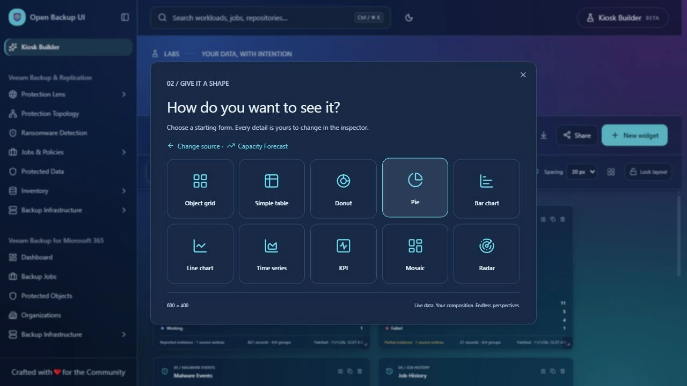

[Open full-size image](images/v1.0.1/04-widget-views.webp)

## 05 · Keep repository names beside their values.

`/labs` · 1 November 2026 · 1270 × 714

Repository Capacity named KPI cards and the live inspector. The current composition was not modified.

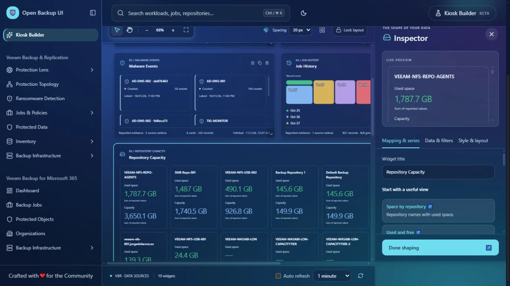

[Open full-size image](images/v1.0.1/05-mapping-series.webp)

## 06 · Publish a view with deliberate access and refresh settings.

`/labs` · 1 November 2026 · 1280 × 720

New-link configuration, before publishing. Password field is empty and no usable share URL is visible.

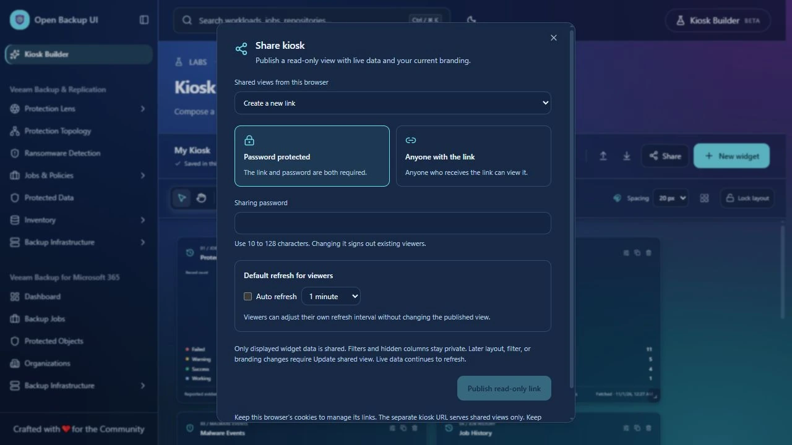

[Open full-size image](images/v1.0.1/06-sharing-controls.webp)

## 07 · A focused, read-only view.

`/share/kiosk/<id>` · 1 November 2026 · 1270 × 714

Existing published My Kiosk in the regular viewer. Browser chrome and the access token are absent.

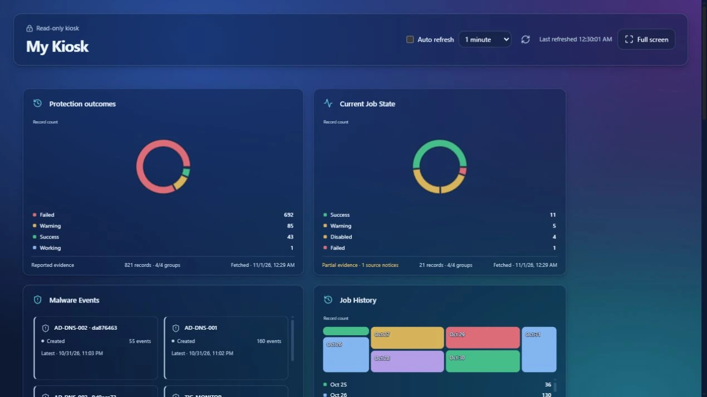

[Open full-size image](images/v1.0.1/07-shared-kiosk.webp)

## 08 · The whole kiosk, fitted to the screen.

`/share/kiosk/<id>` · 1 November 2026 · 1920 × 1080

Native full screen at 1920 × 1080, Fit to TV, ten widgets, idle controls hidden. This is the current published composition, not a mockup.

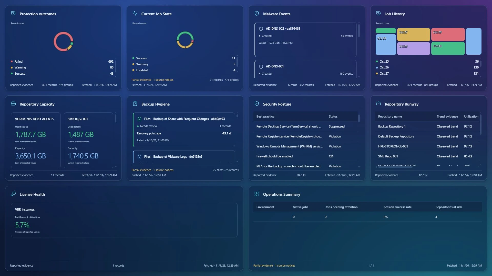

[Open full-size image](images/v1.0.1/08-kiosk-tv.webp)

## 09 · Set the screen layout and refresh interval.

`/share/kiosk/<id>` · 1 November 2026 · 1920 × 1080

The same full-screen kiosk with controls revealed, Fit to TV selected and one-minute auto refresh checked.

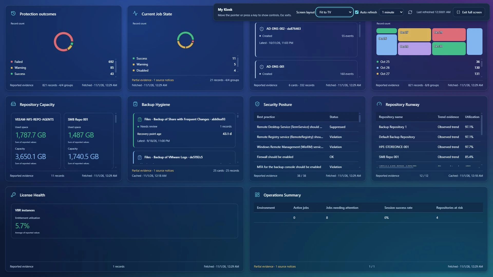

[Open full-size image](images/v1.0.1/09-tv-refresh-controls.webp)

## 10 · Bring cached forecasts onto the monitoring screen.

`/labs` · 30 October 2026 · 1270 × 714

Earlier development capture of cached Capacity Forecast and Operations Summary. Source icons predate the final Lucide alignment; this is a backup-file scenario, not recorded disk utilization.

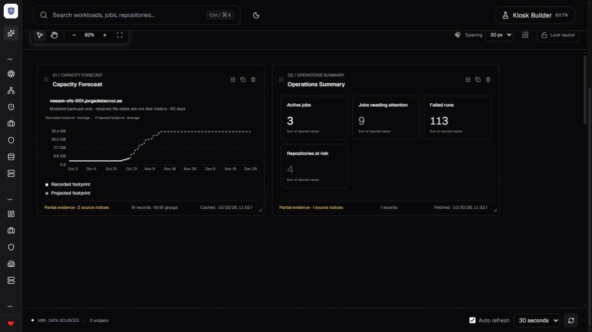

[Open full-size image](images/v1.0.1/10-capacity-monitoring.webp)

## 11 · A forecast preview with real cached evidence.

`/vbr/lens/overview` · 30 October 2026 · 1270 × 714

Reviewed development capture of the Lens selector, showing repository name, cached timestamp, recorded usage and projection.

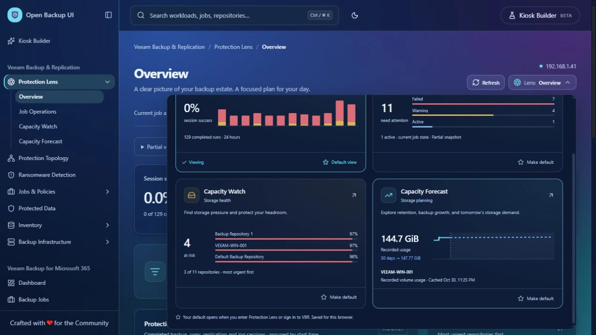

[Open full-size image](images/v1.0.1/11-lens-forecast-preview.webp)

## 12 · Check the provider and discover its model catalog.

`/administration/ai-settings` · 31 October 2026 · 1270 × 714

Live Gemini catalog check: HTTP 200 and 46 returned models. The key input is blank and the saved credential is not shown. Catalog success alone does not verify inference or billing.

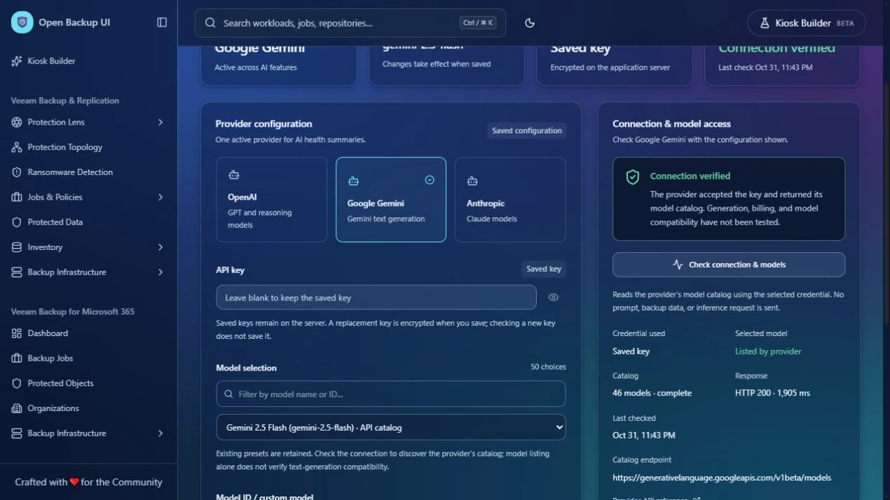

[Open full-size image](images/v1.0.1/12-ai-connection.webp)

## 13 · Read the analysis in the same visual language as the console.

`/vbr/lens/overview` · 31 October 2026 · 1270 × 714

Successful live Gemini summary in the themed panel. Captured before the Export PDF action was added; the export dialog below shows the newer action. Narrative and confidence labels are AI output, not independent validation.

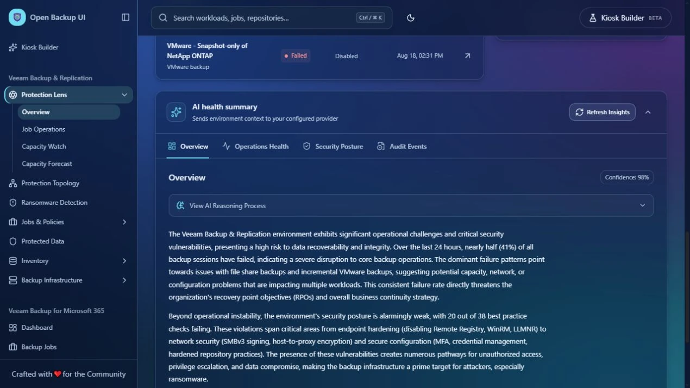

[Open full-size image](images/v1.0.1/13-ai-health-summary.webp)

## 14 · Turn the completed summary into a designed report.

`/vbr/lens/overview` · 1 November 2026 · 1280 × 720

Export dialog and miniature report preview, with A4 selected and optional analysis notes unchecked. The miniature is a designed preview, not a raster of every report page.

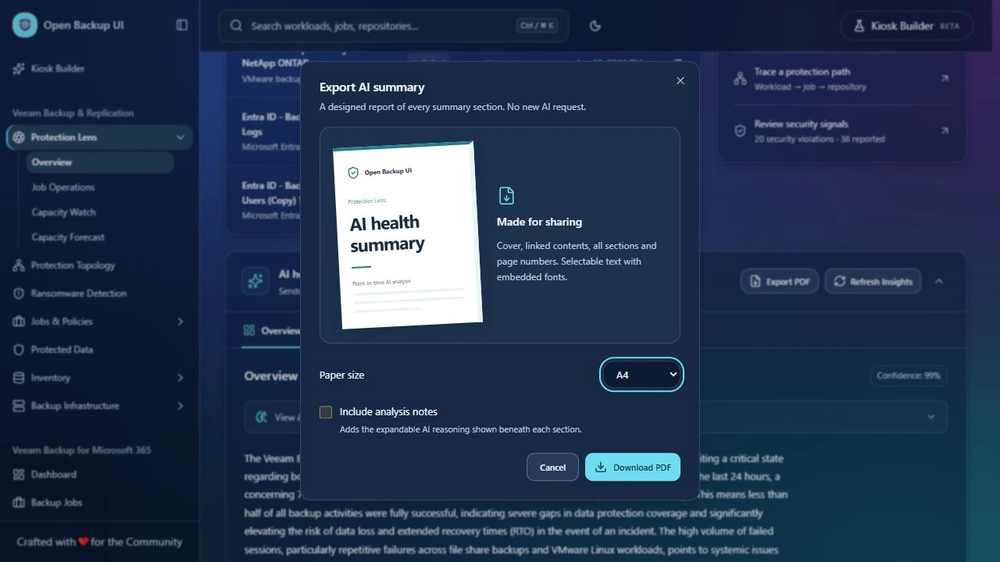

[Open full-size image](images/v1.0.1/14-ai-pdf-export.webp)

## 15 · A clear cover and linked contents.

`Export PDF → Download PDF` · 1 November 2026 · 827 × 1170

Rendered first page of the actual nine-page exported report. Only this cover is included; the private PDF and report body remain outside the release images.

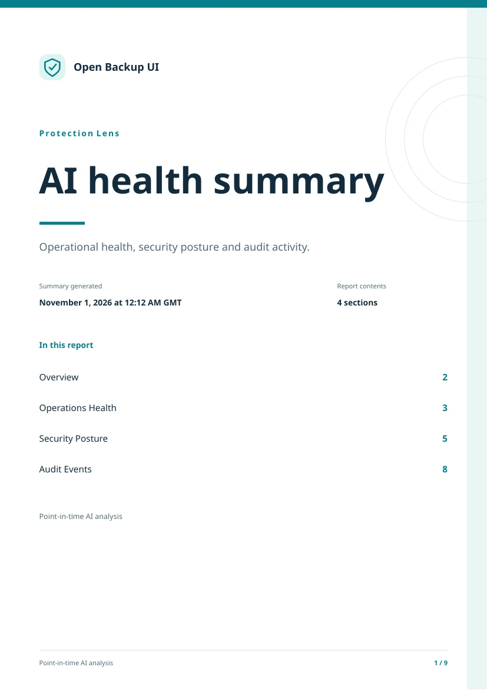

[Open full-size image](images/v1.0.1/15-ai-pdf-cover.webp)
