# Open Backup UI v1.0.1

**From a blank canvas to a monitoring screen, with AI reports ready to take away.**

Version 1.0.1 introduces Kiosk Builder: a personal space to shape your backup evidence into useful views, then share a read-only dashboard that fits a TV and refreshes automatically. It also improves cached forecast previews, AI setup and error feedback, and adds a designed PDF export for completed AI health summaries.

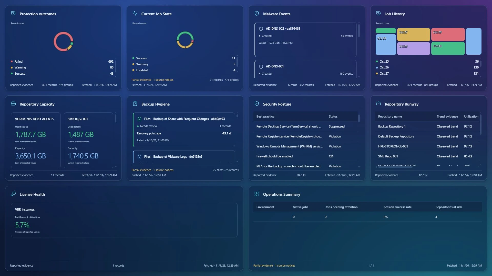

*Ten widgets, one screen, with consistent padding and the console's Glass Aurora theme.*

## The highlights

- **Build your view:** draw on a canvas and choose from sixteen VBR data sources and ten visual forms.
- **Keep the meaning:** show repository and job names, select measures, edit series labels and visibility, and filter the evidence.
- **Make room naturally:** snapping, magnetic alignment and cascading repulsion keep widgets separated as the layout changes.
- **Share deliberately:** publish read-only links, optionally require a password, and update or revoke them explicitly.
- **Put it on a TV:** full-screen fitting, preserved padding, adjustable refresh and controls that fade when idle.
- **Plan from cached evidence:** repository forecasts, runway, backup footprint, retention and hygiene reuse the existing planning cache.
- **Understand AI failures:** provider errors and useful next steps replace an unexplained empty result.
- **Take the summary with you:** export a completed analysis as a polished, multilingual PDF without another AI request.

## Kiosk Builder

### Start with a blank canvas

Enable **Administration → Settings → Labs**, then open **Kiosk Builder** from the top bar or main menu. Draw a rectangle on the subtle grid, or choose **New widget**. Pick the source, choose a visual form, and refine it in an inspector with a live preview.

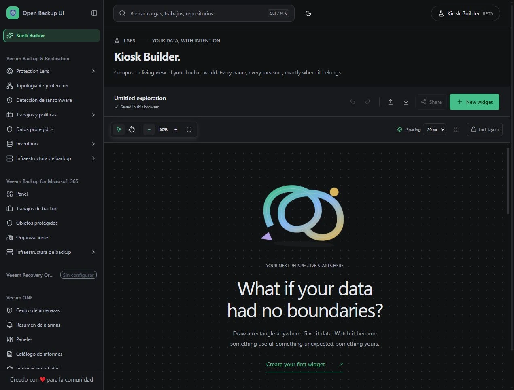

*An invitation to build your first view. This capture uses Spanish navigation; new experimental copy can fall back to English.*

### Choose the evidence and give it a shape

The initial catalog covers **Protected Data, Protected Objects, Job History, Current Job State, Malware Events, Repository Capacity, Security Posture, Capacity Forecast, Repository Runway, Backup Footprint, Retention Evidence, Backup Hygiene, Operations Summary, Backup Proxies, Managed Servers and License Health**.

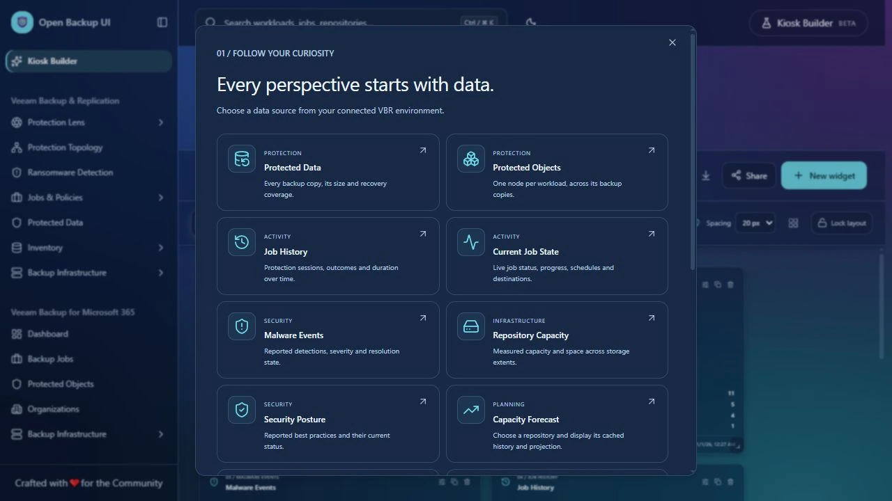

*Relevant icons and descriptions connect each view to its source.*

Choose an **object grid, simple table, donut, pie, bar chart, line chart, time series, KPI, mosaic or radar**. Suggested mappings provide a starting point; the inspector exposes the fields, calculations, filters, columns and series behind the result.

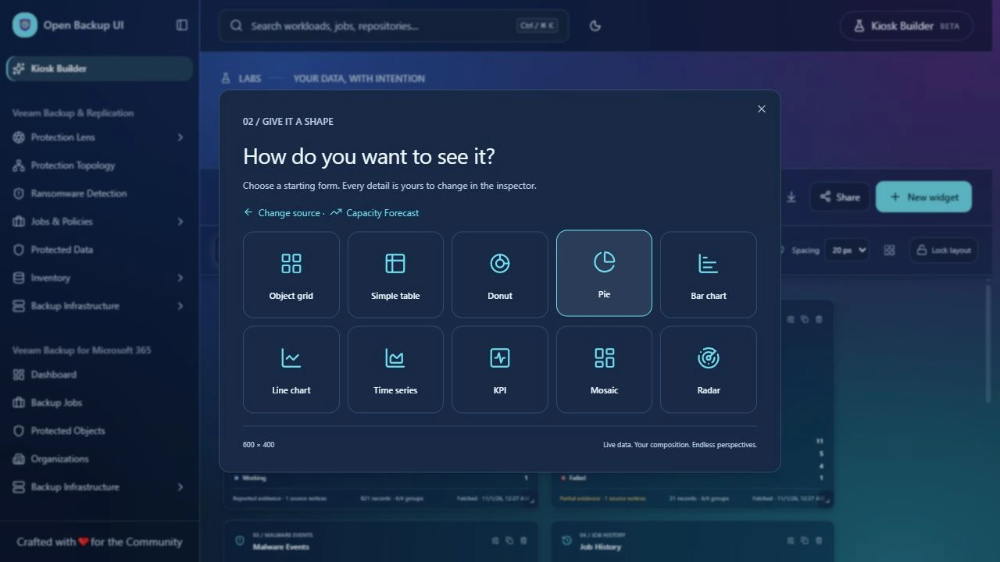

*Start with a form, then shape the detail.*

### Names beside numbers

Repository capacity can show named cards with used and total space, or a stacked used/free comparison. Job history can group outcomes by job or show one time series per job. Rename or hide individual series, select category labels, choose aggregation, and control table columns. Job names resolve by source ID; unresolved sessions keep their reported names with explicit fallback evidence.

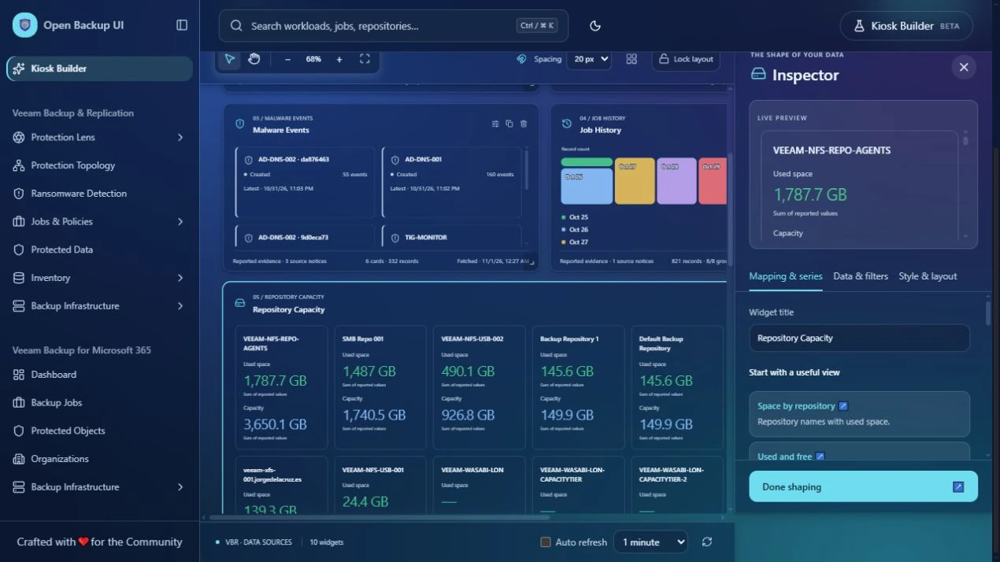

*Repository names stay alongside their capacity values.*

Object grids now use readable cards with names, status, measures, counts and timestamps. Choose grouped objects or individual records. Fonts, colours, density, corners, chart palettes and Glass transparency follow Branding, while source icons remain consistent across the chooser, editor and shared viewer.

### A layout that makes room

Move or resize a widget and its neighbours move aside, or below when they reach the canvas edge. Choose **20, 40, 60 or 80 pixels** of spacing. Magnetic alignment, guides, tidy/lock controls, pan, zoom and undo/redo help keep the composition usable. A complete movement cascade is one undo action.

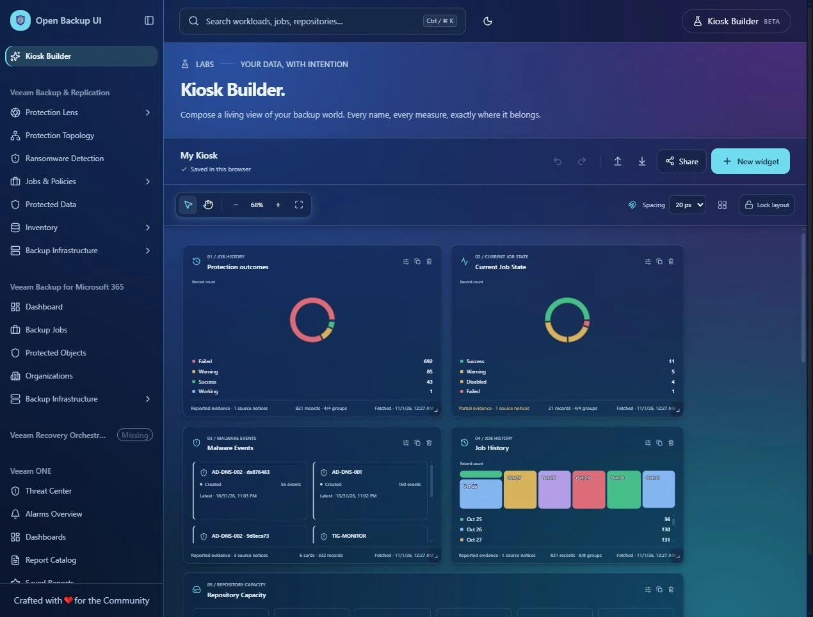

*The current saved canvas, with more widgets available by scrolling.*

Layouts save automatically per browser, origin and selected VBR source. JSON import/export carries configuration, aliases and filters without fetched backup records or credentials.

## Read-only screens, with refresh

### Publish the view you intend to share

Choose **Share**, select link access or password protection, and set the refresh defaults. Publishing captures the layout, visible fields, queries and branding. Later edits stay private until **Update shared view**; **Revoke link** stops future reads.

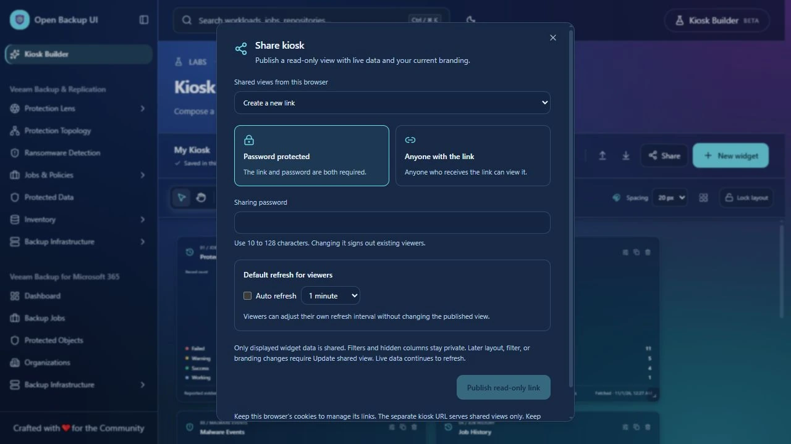

*Access and refresh controls before a link is published. No live access token is shown.*

The viewer exposes the selected display data without editing, connection or configuration controls. Auto refresh supports **30 seconds, 1, 2, 5 or 10 minutes**, pauses in hidden tabs, and preserves dated readings while refreshing.

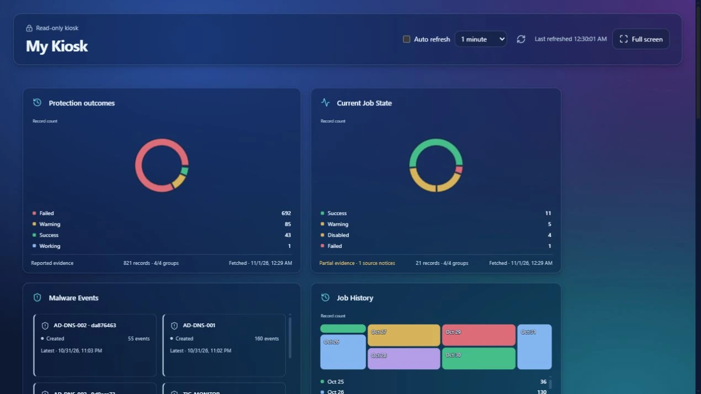

*A focused view of the published composition.*

### Fit the screen

Select **Full screen** for TV mode. **Fit to TV** rearranges widgets to use the available width and height while keeping padding. **Saved arrangement** preserves the original positions and proportions. Neither changes the published composition.

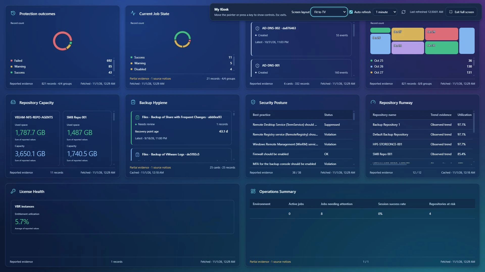

*Full screen with Fit to TV and one-minute auto refresh selected.*

Entering full screen enables auto refresh at the selected interval. Controls fade when idle and return on pointer, touch or keyboard activity; Escape exits. Large collections and tables retain internal scrolling, so focused widgets work best for a screen viewed at a distance.

### A dedicated viewer URL

The kiosk listener can use the server's IP on a separate port, without another hostname. Configure `KIOSK_PUBLIC_ORIGIN`, then run `npm run start:kiosk` alongside the application. Only shared-view routes and their required assets pass through the listener; private routes are blocked and console credentials are stripped.

Keep the main application on loopback or behind your existing network access controls. The viewer listener does not introduce a console login or make an independently exposed editor private. The [Kiosk Builder guide](../labs.md) covers LAN binding, HTTPS, passwords, ownership and revocation. Shared fields are not anonymized, and the full link is an access credential.

## Capacity planning, already in the cache

Choose **Capacity Forecast**, select a repository, then use recorded volume usage or a backup-file retention scenario over **30, 60 or 90 days**. Recorded evidence and future scenarios remain distinct. Add runway, footprint, retention or hygiene widgets for a broader planning screen.

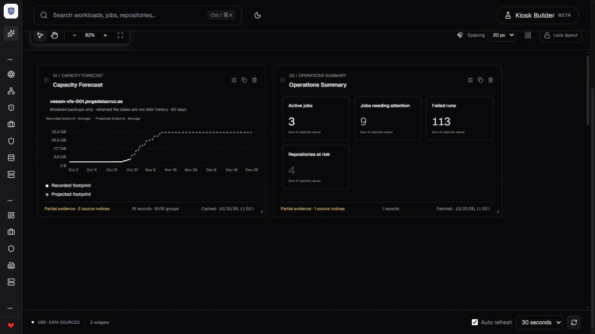

*A development capture of a backup-file scenario and operations KPIs. This scenario is not disk-utilization history.*

Refreshing the kiosk reads the existing scoped cache; it does not launch a collection. Original timestamps, missing history, partial evidence and stale states remain visible. The Lens selector now also previews a cached repository with its name, current reading and supported projection.

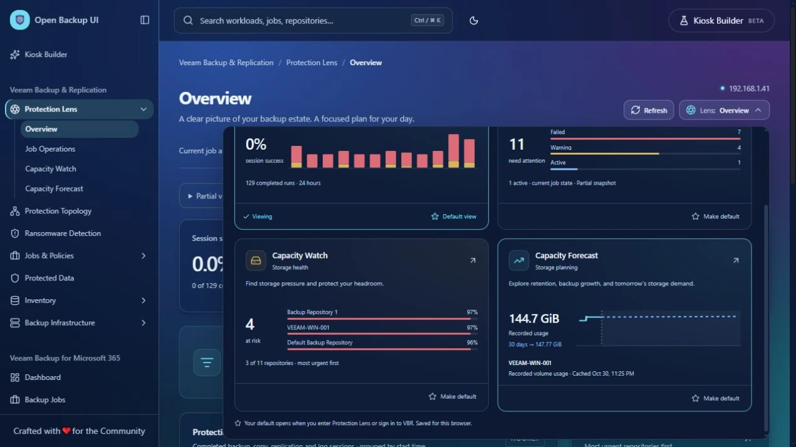

*The miniature now has useful evidence behind it.*

## AI summaries and reports

### Clear setup, clear failures

AI configuration saves now work when accessing the application through local, LAN or proxy URLs. Save and connection-check actions have their own feedback and timeouts. **Check connection & models** reads the provider catalog using the selected credential; it does not send a summary prompt or establish available inference credits.

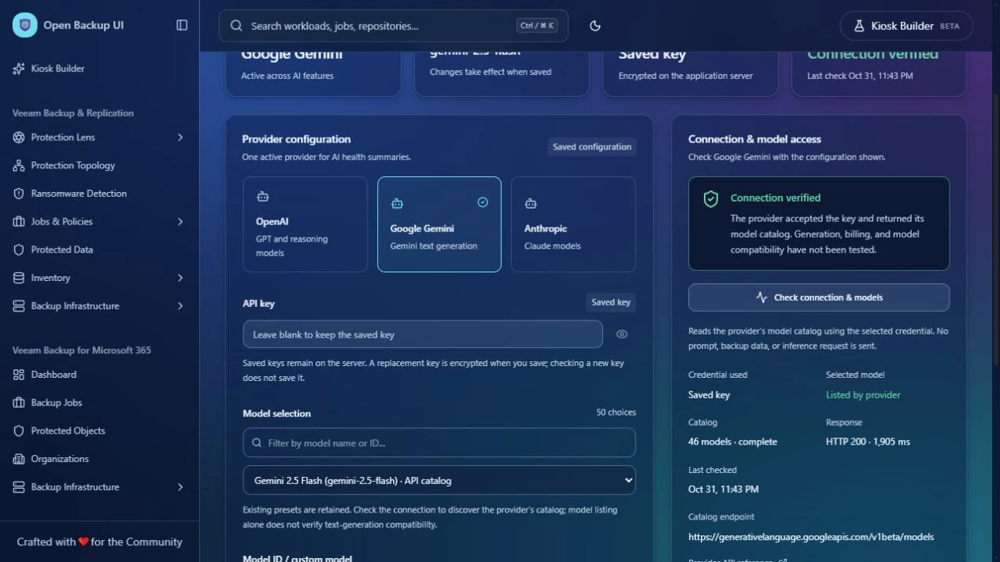

*A live catalog check with the saved key kept on the server.*

The health summary follows the console's typography, colours, Glass surfaces and spacing. Compact tabs, loading and empty states replace the oversized blank panel. Provider failures before or during streaming show a sanitized diagnostic and relevant next steps, including Gemini credit errors. Interrupted or empty responses are not presented as completed analyses.

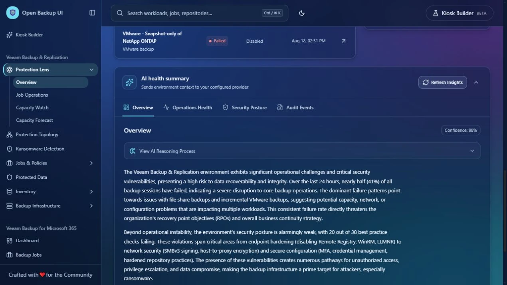

*A successful live summary captured before the PDF action was added. Narrative and confidence labels are AI output.*

### A report designed for reading

Select **Export PDF** on a completed summary. Choose **A4 or US Letter** and whether to include the expandable analysis notes. Every summary section is included, regardless of the selected tab.

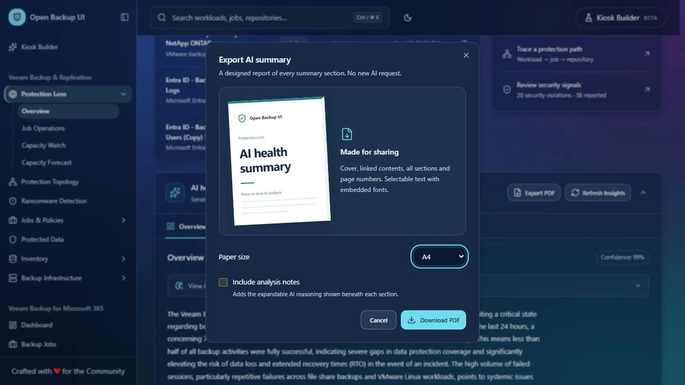

*Paper size, optional notes and a small preview of the report's visual style.*

The report includes a cover, linked contents, numbered sections, recommendation callouts, repeating table headers and page numbers. Text is selectable, and embedded Noto fonts support the application's eleven languages. Export uses the completed result in the browser, without another provider request or server-stored PDF.

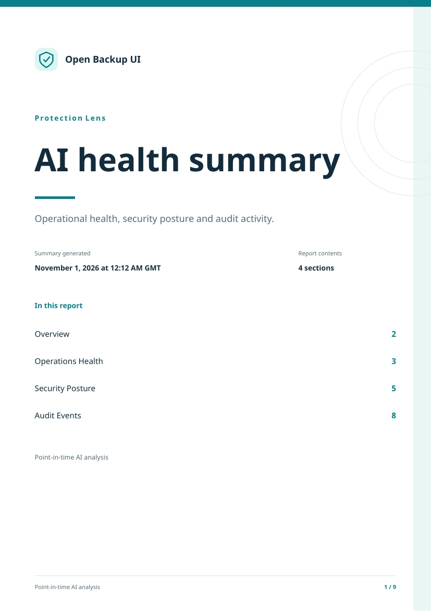

*The rendered cover of the actual nine-page report, with all four sections in its contents.*

See the [PDF export guide](../ai-summary-pdf.md) for behavior and limitations.

## Before upgrading

- Back up persistent `data/` and its encryption key. Shared kiosk definitions and password hashes need persistent storage under `data/kiosk-shares/`.
- Install the updated dependency lockfile with `npm ci`, then rebuild. Report fonts and their licenses are included in the source and deployment assets.
- Labs is disabled by default. Its first source catalog covers VBR; Microsoft 365 and Veeam ONE sources are not included.
- Review the fields and names in a shared screen before publishing. Use suitable network controls and HTTPS; sharing does not add an application-wide login.
- Cached forecasts remain advisory and depend on the available collection history. A screen refresh does not force new planning collection.
- AI generation sends environment context to the configured provider. Downloaded PDFs can contain that context; review the completed report before sharing it.

Local validation passed **995 tests** and the production build. Production dependency audit: **zero advisories**; full development tree: **14 moderate advisories**, with no high or critical findings. See the [validation scope](v1.0.1-validation.md) for remaining checks.

These images show the project lab, including names and addresses. Nine kiosk captures were taken on 1 November; the [15-image gallery](v1.0.1-gallery.md) records the dates and UI differences of the reviewed development captures.

[README](../../README.md) · [Screenshot checklist](v1.0.1-screenshots.md) · [Kiosk Builder guide](../labs.md)
