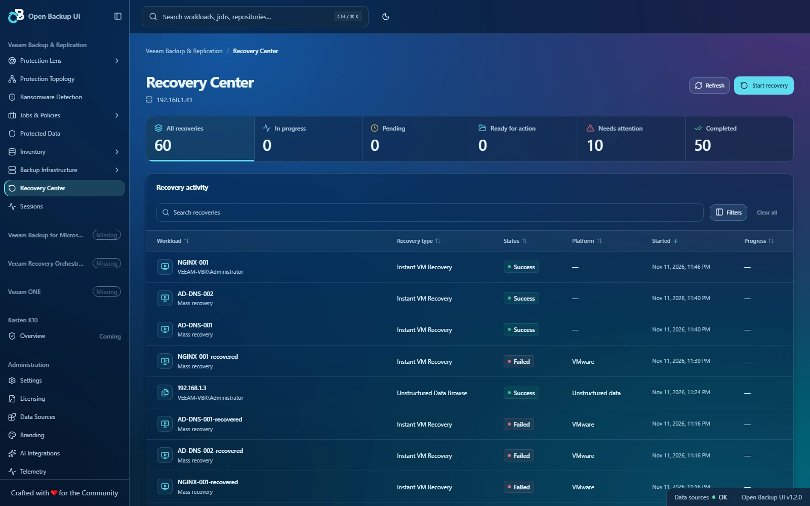
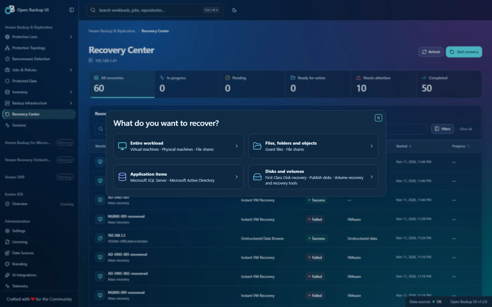
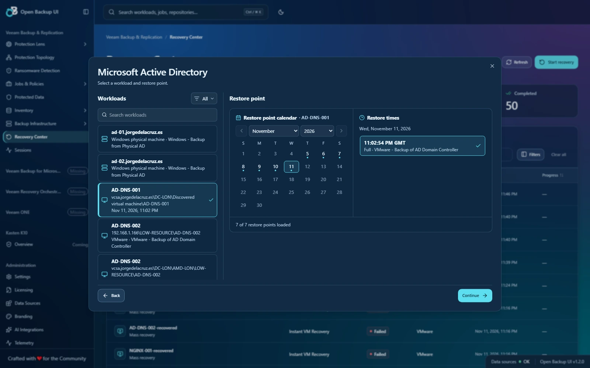
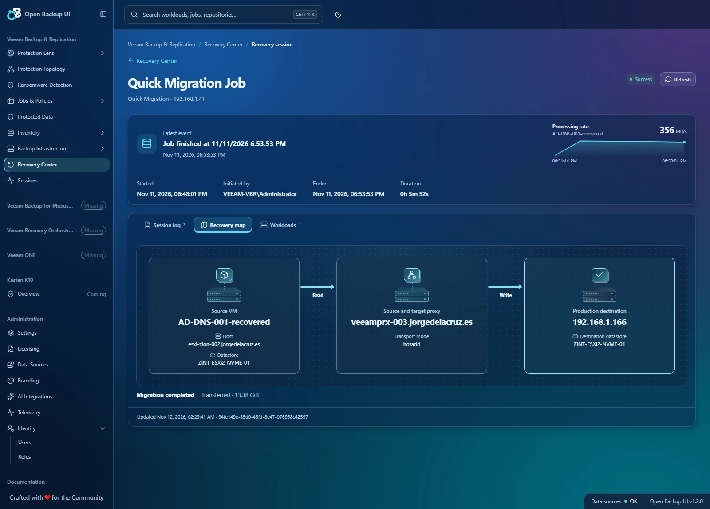
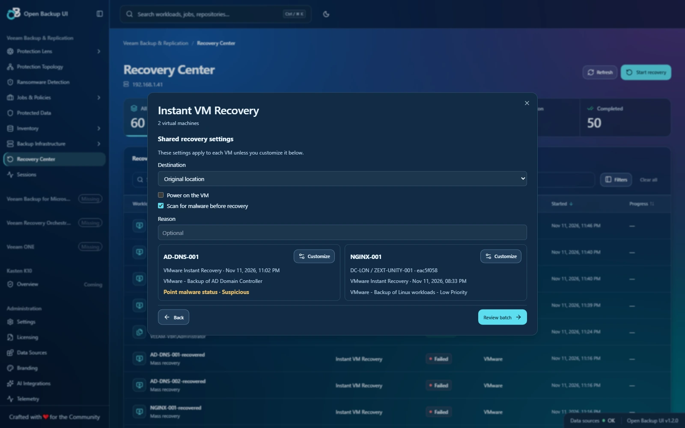
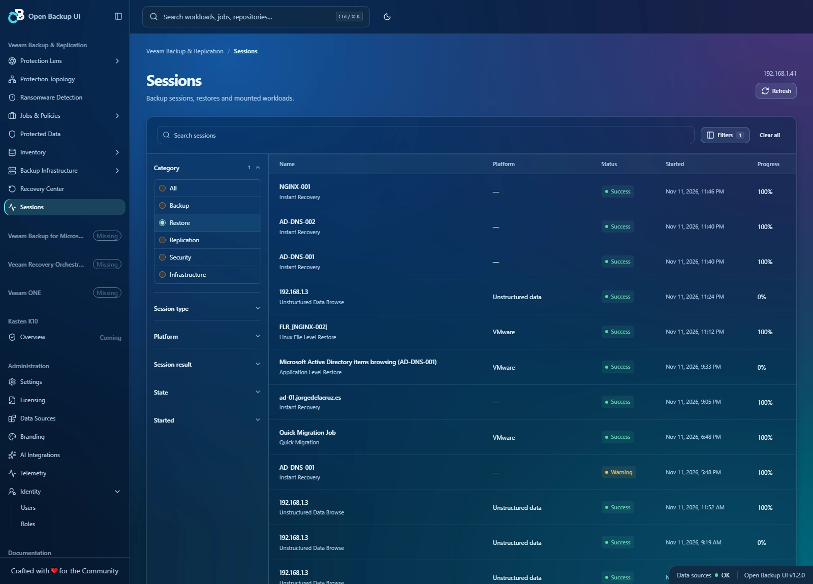
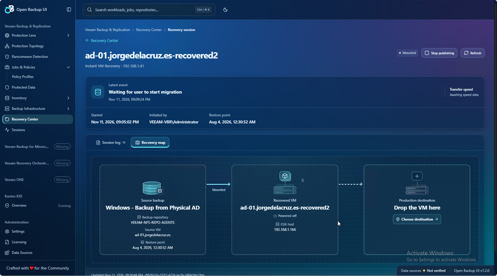
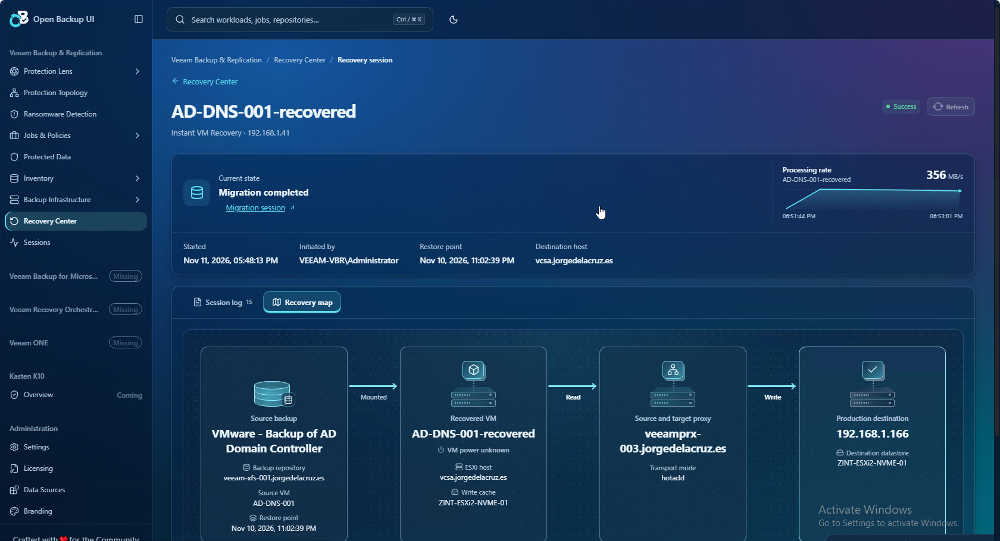

# v1.2.0 visual guide

Eight highlights from Open Backup UI v1.2.0, captured in English with the Glass Ocean theme.

[Release notes](v1.2.0.md) · [Validation scope](v1.2.0-validation.md)

## 01 · Recovery work in one place.

Recovery Center brings recovery history, status quick filters and search into one view. See what is running, ready for action, completed or needs attention.

[Open full-size image](images/v1.2.0/01-recovery-center.webp)

## 02 · Start with the recovery goal.

Choose what you want to recover: an entire workload, files and folders, application items, or disks and volumes. The wizard then narrows the available options.

[Open full-size image](images/v1.2.0/02-recovery-goals.webp)

## 03 · Pick the workload, then the moment.

Eligible workloads sit beside a calendar with month and year controls. The latest available restore point is selected automatically, with individual restore times easy to compare.

[Open full-size image](images/v1.2.0/03-restore-point-calendar.webp)

## 04 · Follow the path to production.

The recovery map connects the source VM, proxy and production destination. Read and write arrows explain the data path, while the processing-rate chart keeps transfer history close to the session details.

[Open full-size image](images/v1.2.0/04-recovery-map.webp)

## 05 · Configure several VMs together.

Apply shared Instant VM Recovery settings across several VMs, then customize individual destinations as needed. Restore-point details and malware flags remain visible before batch review.

[Open full-size image](images/v1.2.0/05-multi-vm-recovery.webp)

## 06 · Keep restores visible in Sessions.

Restores also appear in the global Sessions view. The shared filter panel narrows history by category, session type, platform, result, state and date.

[Open full-size image](images/v1.2.0/06-sessions.webp)

## 07 · Move from mounted recovery to production.

Instant Recovery keeps the source backup, recovered VM and production destination in one map. Choose the production destination when ready to migrate, with Stop publishing available beside the main session details.

[Open full-size image](images/v1.2.0/07-instant-recovery-map.webp)

## 08 · Keep the transfer story with the recovery.

The completed migration retains its processing-rate chart and the full path from backup through the recovered VM and proxy to production. Read and write labels make the proxy's role clear.

[Open full-size image](images/v1.2.0/08-migration-statistics.webp)

Images 01–06 are live lab captures from 12 November 2026; images 07–08 are user screenshots from 11 November, cropped to the application. Completed migration views show retained processing rates from those runs.
