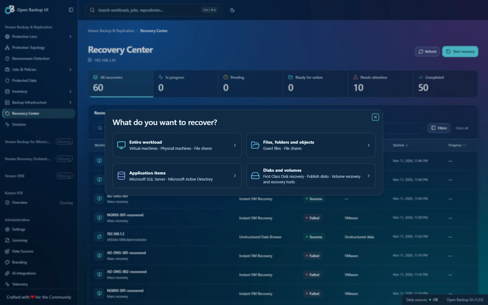
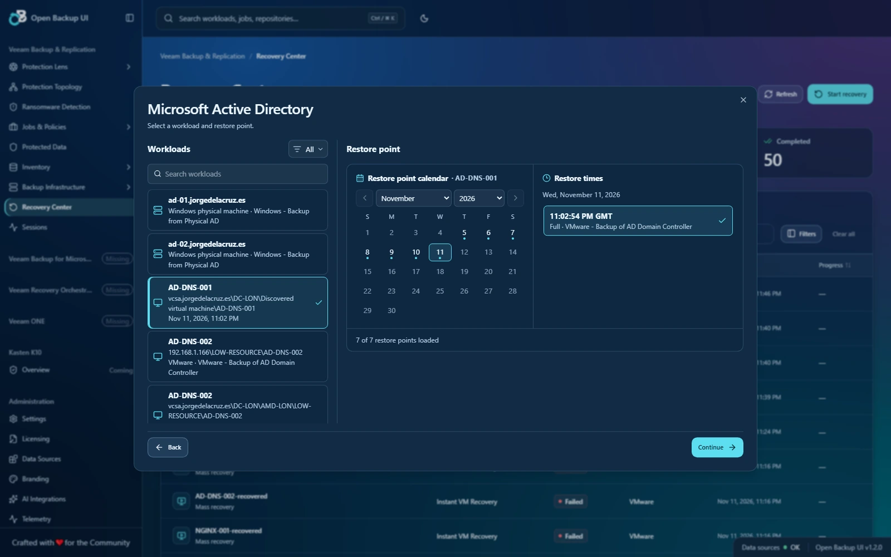
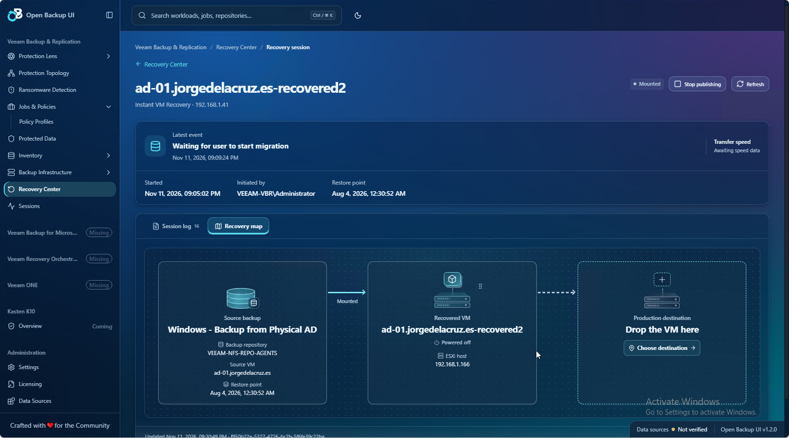
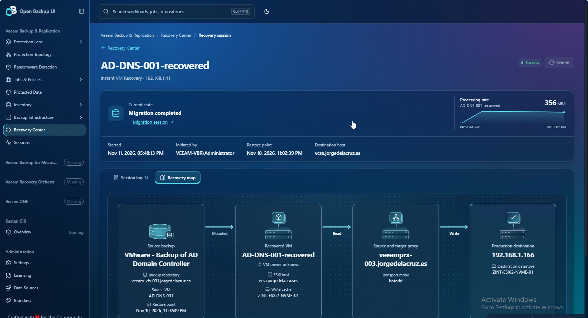

# Open Backup UI v1.2.0

**Recovery Center: choose what you need back, recover it, and follow the work in one place.**

Version 1.2.0 brings recovery into Open Backup UI. Start from a backup's restore point or from the new Recovery Center, choose a supported recovery method, and continue in the session with its logs, files, application objects, or VM recovery map. This release also introduces multi-VM recovery groups, a global Sessions workspace, cached recovery history, and a new OB identity.

These notes describe changes since **v1.0.1**. This is the release draft; the [validation report](https://github.com/jorgedlcruz/open-backup-ui/blob/v1.2.0/docs/releases/v1.2.0-validation.md) records the final QA results and remaining verification limits.

[Visual guide: eight English, Glass Ocean screenshots](https://github.com/jorgedlcruz/open-backup-ui/blob/v1.2.0/docs/releases/v1.2.0-gallery.md)

## Recovery Center

### Start with the recovery goal

The launcher starts with four choices: **Entire workload**, **Files, folders and objects**, **Application items**, and **Disks and volumes**. It narrows the workload list to the methods reported by the connected VBR source. Search by workload name and use the workload-type filter to focus on virtual machines, physical computers, file shares, or object-storage sources.

SQL and Active Directory recovery use application evidence from the backup and restore point. The chooser does not assume that every VM can restore every application.

### Pick the point with context

Workloads sit on the left, with a restore-point calendar and the day's individual times on the right. Jump between months and years, distinguish several points on one day, and review the selected backup copy. The latest eligible point is selected automatically; an explicit selection or a point opened from Protected Data stays selected.

The workload catalog and visited restore-point histories refresh every **30 minutes while Recovery Center is open**. Page **Refresh** updates them immediately. Each backup copy initially contributes up to **200 points**; **Load 200 more restore points** expands the cache without losing the selected point. Loaded depth is retained on refresh. A cold cache still needs to read VBR, and every launch revalidates its source and point.

### Keep recoveries together

Recovery Center lists recovery activity with quick filters for **In progress**, **Pending**, **Ready for action**, **Needs attention**, and **Completed**. A mounted browser or published VM can be ready for its next action even after its initial session reports success.

Recoveries started from Protected Data open here. Opening the same restore through **Sessions** preserves the Sessions breadcrumb and return link. Startup moves into a preparation page, then opens the recovery workspace when it is ready. Reloading follows the recorded request instead of submitting another start.

## VM recovery and migration

- **Instant VM Recovery and Entire VM restore:** choose a supported original or customized destination, set the recovered name alongside placement, and review power, networking, overwrite and available recovery settings before submission.
- **Multi-VM recovery groups:** select a point for each VM and review each destination before starting a group. A group page tracks every VM's outcome, progress and native session. Bulk selection is limited to Instant VM Recovery and Entire VM restore. After group preflight, the application submits one native request per VM in sequence; a group is not an atomic transaction and does not roll back VMs already started.
- **Recovery maps:** see the source backup, recovered or destination VM, host and storage. Entire VM restore and Quick Migration use reported proxy evidence to show the read/write path, with animated connectors while work runs.
- **Migrate to production:** configure the production placement from the Instant Recovery workspace, then follow the native migration session and its progress. The map retains verified destination information after a reload.
- **Actions with the session:** Stop restore, Unmount, End browsing and Stop publishing appear with the main session controls when applicable. Completing migration no longer hides Stop publishing while VBR still reports an active publication.
- **Short-term throughput history:** compact charts show collected rates beside the current event when data is available. History expires twelve hours after the session finishes. Proxy-path labels use the reported task rate; they are not independent measurements of each network link.

VM options depend on the platform and the restore point's allowed operations. The implemented paths include VMware vSphere, Hyper-V and original-location Cloud Director restore where reported, plus eligible First Class Disk recovery and disk publishing. Customized Cloud Director placement is not included. Secure-restore controls currently expose antivirus scanning; YARA scanning is disabled in the submitted specification. See the [VM API map](https://github.com/jorgedlcruz/open-backup-ui/blob/v1.2.0/docs/vm-restore-api.md) for the implemented paths and the wider provider reference.

*A mounted VM is ready for migration, with destination selection in the map and Stop publishing beside the session controls.*

*A completed lab migration with its recorded processing-rate history. [The visual guide](https://github.com/jorgedlcruz/open-backup-ui/blob/v1.2.0/docs/releases/v1.2.0-gallery.md) includes the other release highlights.*

## Files, folders and application items

### Guest files

Mounted guest-file recovery opens directly in **Guest files**, with an expandable folder tree, breadcrumbs, paged directory contents and filename or wildcard search. Linux mounting offers VBR's eligible original hosts, helper hosts and mount servers; using the original machine requires it to be reachable.

The recovery cart holds selections from different folders. Search it, remove individual paths, clear it, or undo a clear. Review a restore to the **original machine/location** inside the workspace, choose **Keep both copies** or **Overwrite existing files**, and complete the native guest authentication or path questions when needed. The guest-file UI does not offer a general destination on another VM. A prepared cart can also be downloaded as a ZIP.

Once a file restore is accepted, the file browser returns automatically. A single inline task area shows its percentage, result and expandable details while browsing continues. Cart selections and the operation receipt survive a page reload in the same browser tab. An unconfirmed response is distinguished from a confirmed failure and does not invite a duplicate submission.

### Microsoft Active Directory

Browse domains and containers in a tree, search directory objects, and inspect their attributes. Distinct object icons make users, groups, computers and other directory items easier to recognize. **Restore**, **Export** and the **Recovery cart** sit above the object grid. Selections can span folders within the mounted directory, with VBR's validation and restore/export workflows kept inside the recovery session.

### Microsoft SQL Server

Browse servers, instances and databases in a split workspace. Actions reflect the current server, instance or selected databases:

- Instant database recovery and database restore to the original location or another server.
- Point-in-time choices when the selected databases share an eligible transaction-log window.
- Export to a backup file (`.bak`) or database files, and publish selected databases to another server.
- Native destination, credential, file-placement and recovery questions, followed by operation status and applicable mounted-database actions.
- SQL staging-server configuration for advanced recovery, including the Windows account and SQL authentication options.

These controls follow VBR's available workflows and validation responses. They do not promise every desktop Explorer feature on every server build.

### NAS and object-storage backups

File shares and object-storage sources join the same goal-first launcher. Choose a restore point in the calendar, then browse its backed-up folders or objects, search, collect selections and use the available restore or copy actions. NAS browsing now uses a folder tree and breadcrumbs, consistent with guest-file recovery. To recover an older version, select its restore point before browsing; per-item version selection and all-time browsing are not offered.

**Copy to** can browse a destination server's live folders. Submitting the copy closes its review form and leaves the source browser available. A compact Operations control tracks individual copies/restores and their native task progress; checking status does not resend the operation. Results remain accessible after the browse mount ends.

Entire-source restore and rollback are available for eligible NAS and object-storage points. Instant file-share publishing, migration and switchover appear where VBR reports support. An object-storage **source backup** is distinct from a VM or file backup whose **repository** happens to use object storage.

### Physical computer recovery

Eligible computer backups expose guest files, recorded application items, Instant Recovery to a VM, and disk publishing where supported. Volume recovery is limited to **Windows physical-computer backups** and a **connected, verified Windows recovery appliance**. It uses source/destination disk mappings and a final native layout check. Eligible Windows computer backups also offer recovery-media generation and time-limited recovery tokens. Generating media or a token does not start a disk restore.

## Sessions and visual polish

- **Sessions** provides a global view of backup activity, restore runs and mounted workloads. The shared filter rail includes operation groups, session types, platform, state, result and time window.
- Investigation keeps current state, native logs, workload evidence and recovery controls together. Browse sessions omit the unrelated Workloads tab.
- The new **OB Interlock** icon combines a restore arrow with a checked B. It adapts to light and dark surfaces, retains the existing Open Backup UI wordmark, and works in the collapsed sidebar.
- **Glass Ocean** is the default appearance for a new browser configuration. Existing appearance choices remain available. Search fields, inputs and recovery surfaces follow the selected theme.
- A connection-status footer displays source health and **Open Backup UI v1.2.0**. Source headers and a tracked-file manifest record the release version across the project.
- Loading feedback combines the real operation state with a rotating spinner and **200 shuffled playful captions**. Captions do not replace progress or announce fictitious completed work.

## Reliability improvements

Recovery requests preserve exact source, object, backup and point identity through selection and submission. Source/account-scoped receipts and duplicate-submit checks reduce accidental resubmission after interrupted responses. Cache reads remain responsive during background refresh, failed authorization invalidates cached access, and partial inventory stays explicit.

This release also fixes several issues found during hands-on review: missing SQL database rows, Linux helper-host discovery, stalled Explorer handoffs, native NAS path separators, Copy to payloads for a selected restore point, migration progress and cleanup visibility, and multi-VM validation returning `Not found` for otherwise valid backup objects.

The final QA pass adds durable single-restore acknowledgements across slow responses and reloads, native-attempt records that prevent duplicate dispatch after stale-lock races, completed SQL operation status read from its lasting session record, and the kiosk launcher's dependencies in the standalone archive. The candidate passed **1,275 automated tests** and its production build; the [QA report](https://github.com/jorgedlcruz/open-backup-ui/blob/v1.2.0/docs/releases/v1.2.0-validation.md) records browser checks and the remaining live acceptance scope.

## Compatibility and upgrade

1. Back up the existing instance's persistent `data/` directory and encryption key. Keep the same key when upgrading so saved connections remain readable.
2. Install the v1.2.0 source with `npm ci`, then run `npm run build` and start it using your existing deployment method. The source package supports building on Windows; the standalone artifact is built for Linux by the release workflow.
3. Keep recovery receipts and operation state under persistent `data/`. Workload/restore-point caches are in memory and rebuild after restart; browser carts and some file-operation history belong to the originating browser tab.
4. Review the [deployment guide](https://github.com/jorgedlcruz/open-backup-ui/blob/v1.2.0/docs/deployment.md) and [Recovery Center workflow guide](https://github.com/jorgedlcruz/open-backup-ui/blob/v1.2.0/docs/recovery-center-workflows.md), including your application's trusted access boundary and TLS settings.

The new recovery integration targets **VBR 13 / REST `1.3-rev2`**. Some application and unstructured-data workflows use VBR's **private Web UI APIs**, whose contracts can change between builds. Application recovery requires an HTTPS VBR source with saved credentials for an account that can sign in to the VBR web console. Its HTTPS listener defaults to port 443; `VBR_EXPLORER_HTTPS_PORT` supports another configured port. API access alone does not establish permission to perform every recovery.

First Class Disk is a VMware recovery method; physical volume recovery is a separate workflow. Nutanix recovery, an embedded VMware console and Active Directory comparison with production are not included. The API map catalogs some native capabilities beyond the controls implemented here.

See the [validation report](https://github.com/jorgedlcruz/open-backup-ui/blob/v1.2.0/docs/releases/v1.2.0-validation.md) for the distinction between automated regression coverage, browser checks, live read-only verification and restore operations that still need an operator's acceptance test. This remains an independent community project, not a vendor-certified recovery console.
