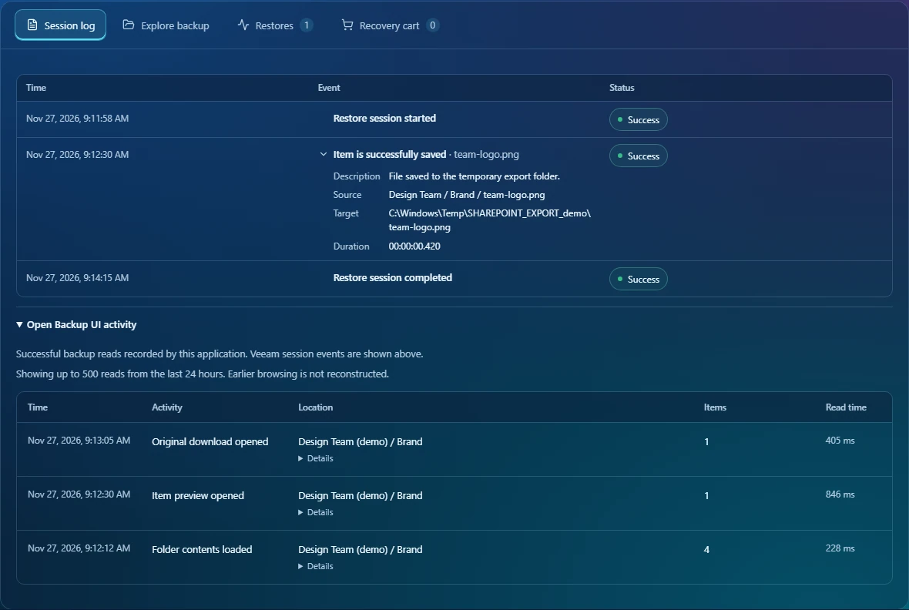
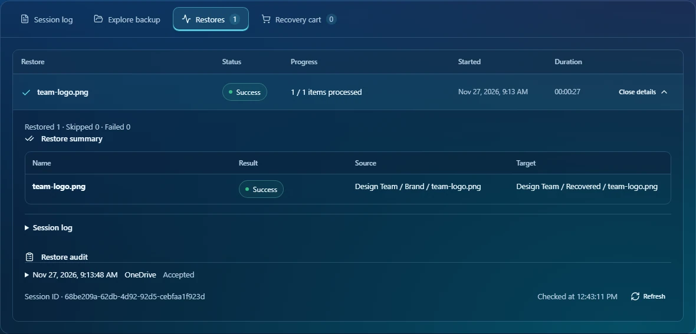
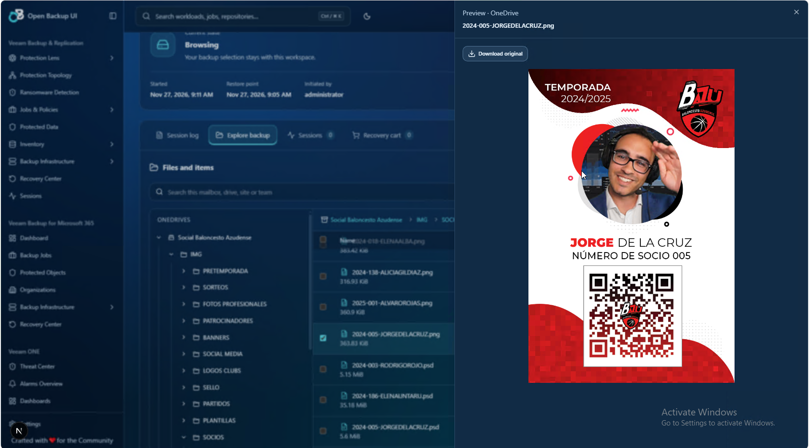

# Open Backup UI v1.3.0 — Black Friday edition

27 November 2026

The v1.2.0 Recovery Center brought VBR restores into the browser. This Black Friday release brings that workflow to Veeam Backup for Microsoft 365. Open a backup, look inside the item you came for, and follow its restore all the way to the result Veeam reports.

## Highlights

- Recover Exchange, OneDrive, SharePoint and Teams items. See what users previewed or downloaded in the web UI and which items Veeam restored, skipped or failed.
- Preview Exchange messages, PDFs, images and common text files before restoring. Download the original when you need it.
- **VBR v13.2 readiness.** When the server confirms REST API revision `1.3-rev3`, Open Backup UI enables additional inventory searches and job editors.

## What happened in this Microsoft 365 session?

Suppose you preview a PNG twice, download its original, then restore it once. Veeam can write a temporary export for each read and log “Item is successfully saved” several times. To find out whether the PNG reached its restore destination, open **Restores** and expand the operation. The workspace gives you three ways to investigate it.

| Where to look | What it tells you |
| --- | --- |
| **Session log** | Veeam’s timeline for the open session. Expand an event for its full message, source, target and duration. A target in a temporary export directory explains a save during browsing. The parent session’s processed total includes work Veeam did for that session. |
| **Open Backup UI activity** | Expand this section beneath the timeline for successful reads through the web UI, including opening folders, searching, previewing an item or opening its original download. Rows include the time, location, item count and read time where available. Up to 500 reads from the last 24 hours are available per scoped browse session. |
| **Restores** | One row per restore operation shows status and progress. **Details** opens per-item results with reported source and target, restored/skipped/failed counts, the child session log and the request audit. An accepted request can still be running. An unconfirmed outcome stays visible for destination or Veeam-history verification before retrying. |

The session heading, breadcrumb and browser tab include a short session ID. Use it to distinguish two restores of the same mailbox or drive. The full ID remains available for support and log correlation.

## What you can preview

| Backup item | In the browser |
| --- | --- |
| **Exchange mailbox message** | Read the HTML or plain-text body with sender, recipients, dates and attachment names where available. HTML runs in an isolated reader with remote images blocked. **Download original** returns an Outlook `.msg` file. |
| **PDF** | Open a `.pdf` in the browser’s PDF viewer. |
| **Images** | View `.png`, `.jpg`, `.jpeg`, `.gif` and `.webp` in the preview panel. |
| **Text** | Read `.txt`, `.log`, `.csv`, `.md` and `.json` as plain text. |

File previews apply to OneDrive documents, SharePoint documents and Teams channel files. The inline file limit is **16 MiB**. The text viewer displays the first **1 MiB**. Use **Download original** for eligible larger files and formats such as Word, Excel or PowerPoint. The Exchange reader opens mailbox messages. Standalone mail files in a document library use the original download.

*Jorge’s original OneDrive screenshot shows the membership card open directly from backup. The session log and restore result examples above use fictional data.*

## Finding and restoring an item

- Start in **Microsoft 365 → Recovery Center** or from **Protected Objects**. Pick an object and a restore point on the calendar. The protected-object HexMap now labels resources by name.
- In Exchange, folders stay in the tree. Opening a folder lists up to 100 items, and **Load more** fetches the next page. The explorer can open while history loads. Returning to pages already read in the same browse session reuses the cached results.
- Review selected items and destination settings in the recovery cart. Up to 100 selections can be submitted in a request. Teams supports inspection of individual posts and original-location recovery for supported selections.
- If a known repository proxy is offline, opening a browse session can wait up to 30 minutes for it to return. Request receipts let the UI reconcile a lost response without automatically submitting the restore again.

## VBR inventory, jobs and Settings

- **Microsoft Entra ID inventory** brings tenants, regions, cache repositories, linked backup jobs and their last runs into one view. See the latest available Entra restore point, add a tenant using an existing application credential, or open the backup-job wizard.
- **VBR v13.2 and REST API `1.3-rev3`.** Open Backup UI negotiates the API revision with each configured VBR connection. Existing v13 servers keep the workflows their revision supports. A confirmed `1.3-rev3` enables inventory search by platform and name across vSphere, Hyper-V, Cloud Director, Nutanix and Proxmox.
- **Revision-gated job editors** cover ten job or policy types across Red Hat OpenStack and Virtuozzo backup, UNIX and Mac agents, vSphere and Windows/Linux CDP, and Storage Copy. Review the validated definition before creating or editing a job. These v13.2 paths were checked against the supplied API specification and test fixtures. Live v13.2 appliance validation is pending.
- **Settings** stays at the bottom of the sidebar. Licensing uses the selected VBR and Microsoft 365 connections, existing settings links open their corresponding sections, and **Exit settings** returns to the previous workspace. The product menu shows configured data sources.
- **Update notifications** appear in the header when a newer stable GitHub release is available. **Settings → Updates** shows the installed and published versions, three highlights and the full notes. Installation remains manual.

## Upgrading from v1.2.0

Keep the existing `data/` directory, encryption material and local environment configuration when replacing the application files. For a source installation, install the locked dependencies and rebuild. The standalone package has its own startup instructions. [Deployment guide](../deployment.md) · [Standalone guide](../../STANDALONE.md) · [v1.2.0 release notes](v1.2.0.md)
